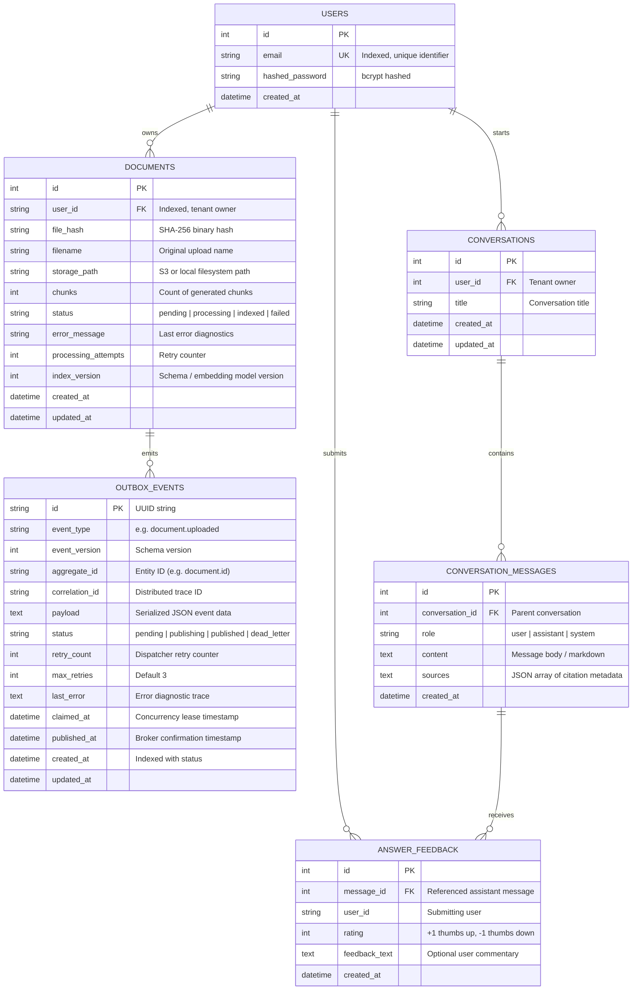

# Database Architecture & Storage Design

## 1. Relational Database Architecture (PostgreSQL / SQLite)

The relational database serves as the authoritative system of record for all business entities, authentication credentials, conversation histories, feedback records, and the transactional outbox queue.

### Entity-Relationship Diagram



### Table Definitions & Indexing Strategy

#### 1. `documents` Table
- **Primary Key**: `id` (`INTEGER`, Auto-increment).
- **Compound Index**: `('user_id', 'status')` — Optimizes dashboard document queries filtered by authenticated user and processing status.
- **Index**: `('file_hash')` — Accelerates duplicate detection during file uploads.
- **Foreign Key**: `user_id` references `users(id)` with cascading deletion.

#### 2. `outbox_events` Table
- **Primary Key**: `id` (`VARCHAR(36)`, UUID string).
- **Compound Index**: `('status', 'created_at')` — Enables high-speed polling for pending events (`status='pending' ORDER BY created_at ASC`) and identifies expired leases (`status='publishing' AND claimed_at < threshold`).
- **Index**: `('aggregate_id')` — Allows rapid lookup of domain events related to a specific document.
- **Index**: `('correlation_id')` — Traces events across distributed service boundaries.

#### 3. `conversations` & `conversation_messages` Tables
- **Foreign Key**: `conversations.user_id` references `users.id` (ON DELETE CASCADE).
- **Foreign Key**: `conversation_messages.conversation_id` references `conversations.id` (ON DELETE CASCADE).
- **Index**: `('conversation_id', 'created_at')` — Fast chronologically ordered message loading for conversation context construction.

---

## 2. Vector Database Architecture (ChromaDB)

ChromaDB provides dense vector storage and Approximate Nearest Neighbor (ANN) search using cosine distance over `all-MiniLM-L6-v2` 384-dimensional embeddings.

### Vector Record Structure

```text
ChromaDB Record:
├── id: str           -> "{document_id}:{chunk_index}" (e.g. "101:0", "101:1")
├── embedding: List   -> 384-dimensional float vector
├── document: str      -> Raw text chunk content (e.g. 1000 characters)
└── metadata: Dict
    ├── user_id: str         -> Tenant isolation identifier
    ├── document_id: int     -> Relational foreign key
    ├── file_hash: str       -> SHA-256 fingerprint
    ├── filename: str        -> Display filename
    ├── chunk_index: int     -> Sequential chunk order
    └── token_count: int     -> Precomputed token length
```

### Vector Collection Management
- **Collection Name**: Configurable via settings (`settings.chroma_collection_name`, default `"research_documents"`).
- **Distance Metric**: Cosine similarity (`{"hnsw:space": "cosine"}`).
- **Tenant Isolation**: Every vector query enforces a strict metadata filter:
  ```python
  collection.query(
      query_embeddings=[query_vector],
      where={"user_id": str(current_user.id)},
      n_results=top_k
  )
  ```
  Vectors are physically partitioned or logically isolated by `user_id`, ensuring cross-tenant data leakage is impossible at the database level.

---

## 3. Distributed Cache & Coordination Store (Redis)

Redis 7 serves three distinct operational roles:

| Role | Key Namespace | Serialization | TTL Policy | Eviction Strategy |
|---|---|---|---|---|
| **Retrieval Cache** | `retrieval:{sha256(user_id:doc_ids:query:config)}` | JSON string | 3600 seconds (1 hour) | `volatile-lru` |
| **Job Queue (RQ)** | `rq:queue:document-indexing` | Redis list / set | Ephemeral | `noeviction` |
| **Rate Limiter** | `ratelimit:{user_id}:{minute_epoch}` | Integer counter | 60 seconds | Expire on write |

---

## 4. Key Database Design Decisions Defended

### 1. Why keep document metadata in SQL instead of ChromaDB?
- **Relational Integrity & ACID**: Document ownership, user credentials, conversation threading, and outbox transactional guarantees require ACID compliance and foreign key constraints that vector databases do not provide.
- **Independent Index Reconstruction**: If ChromaDB data is corrupted or lost, the entire vector index can be reconstructed from scratch using the authoritative SQL metadata and immutable S3 binaries.
- **Fast Status Queries**: Checking whether a document is `processing`, `indexed`, or `failed` in SQL takes less than 1 millisecond and does not load high-dimensional vector indices into memory.

### 2. Why use stable deterministic vector IDs?
- Ingestion workers use the deterministic format `{document_id}:{chunk_index}`.
- If a background job is retried or executed twice due to network timeout, ChromaDB upserts the vector in place. This guarantees **idempotency** and prevents orphaned duplicate vectors from polluting search results.

### 3. Why does a conversation belong strictly to one authenticated user?
- Multi-user conversation sharing introduces complex permission boundaries and cross-tenant leakage risks.
- Enforcing `conversation.user_id == current_user.id` on every query, message load, and deletion guarantees that users can never access or manipulate another researcher's query history (preventing IDOR vulnerabilities).

### 4. Why should document deletion coordinate SQL, storage, and vectors?
- Deleting an entity from SQL while leaving its raw file in S3 wastes storage and violates data retention policies.
- Leaving vectors in ChromaDB after SQL deletion causes "ghost retrieval"—the LLM retrieves and cites chunks from documents the user believes have been deleted. Coordinated multi-system deletion guarantees complete lifecycle consistency.

### 5. Why are database migrations preferable to automatic table creation?
- `Base.metadata.create_all()` cannot alter existing columns, add constraints, modify indices, or backfill data without dropping tables.
- Alembic migrations provide version-controlled, auditable, and reversible schema changes (`alembic upgrade head`, `alembic downgrade -1`) suitable for zero-downtime production rollouts.

### 6. How do you handle partially completed cross-system operations?
- Coordinated distributed operations use the **Transactional Outbox Pattern** combined with **Saga-like compensation**.
- If a downstream worker fails halfway through processing, the document's SQL status is transitioned to `failed`, an outbox event (`document.failed`) is recorded, and any intermediate vector chunks are cleaned up on retry via deterministic ID overwrite.
