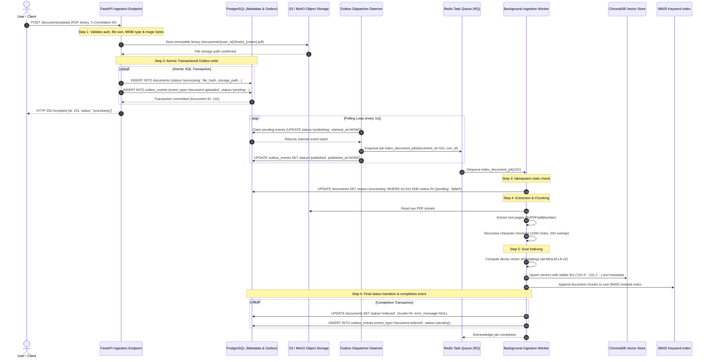
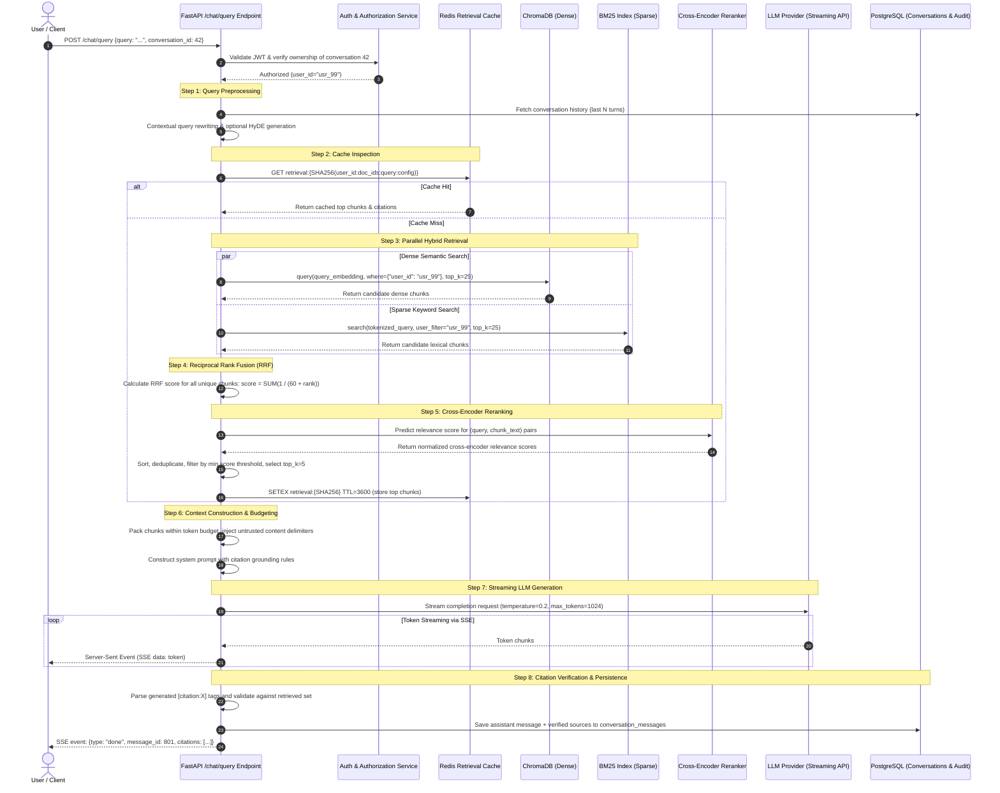
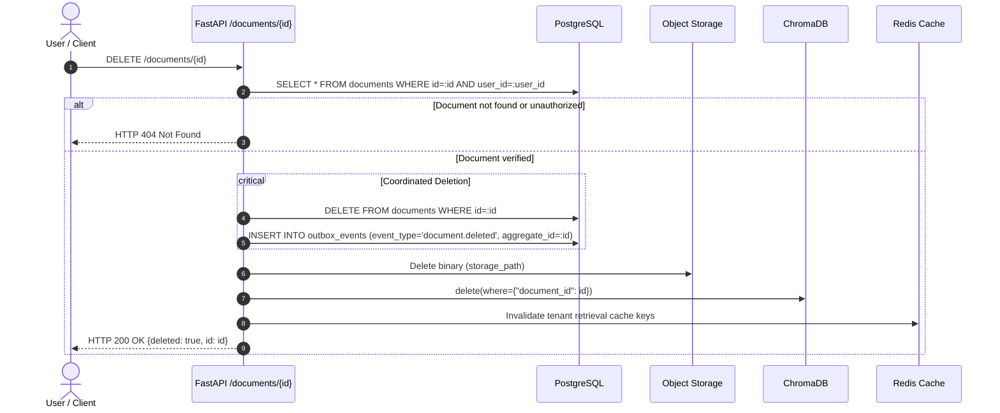
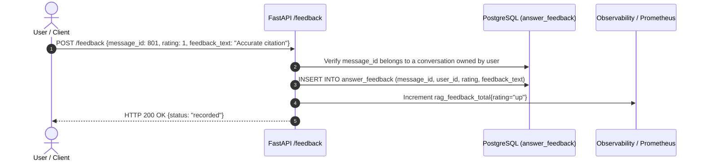

# Data Flow & Execution Pipelines

## 1. Overview

The AI Research Assistant operates across four primary data pipelines:
1. **Document Ingestion Pipeline**: Asynchronous, fault-tolerant extraction, chunking, and indexing.
2. **RAG Query & Inference Pipeline**: Synchronous, multi-stage hybrid retrieval, reranking, and generation.
3. **Document Lifecycle & Deletion Pipeline**: Coordinated cross-system purge of SQL, object storage, vectors, and caches.
4. **User Feedback & Evaluation Pipeline**: Continuous feedback capture and RAG quality evaluation.

---

## 2. Document Ingestion Pipeline

### Architectural Decisions in Ingestion

1. **Transactional Outbox Eliminates Dual-Write Risk**: Document metadata and the `document.uploaded` outbox event are committed within the exact same database transaction. Even if the application crashes or the Redis broker is offline, the upload succeeds and the job will be dispatched once connectivity resumes.
2. **Stable Deterministic Vector IDs**: Chunks use the format `{document_id}:{chunk_index}`. If a worker crashes halfway through or an event is re-delivered, re-running the job overwrites existing vectors idempotently rather than creating duplicate vector entries in ChromaDB.
3. **Atomic Claiming at Worker Level**: Workers execute an atomic conditional update (`UPDATE documents SET status='processing' WHERE id=:id AND status IN ('pending', 'failed')`). If two workers pull duplicate messages, only one gains processing rights; the second skips execution safely.
4. **Dedicated Sources of Truth**:
   - **PostgreSQL**: Authoritative for document existence, ownership, status, chunk counts, and lifecycle.
   - **Object Storage**: Authoritative for raw immutable PDF binaries.
   - **ChromaDB**: Authoritative for vector similarity representation.
   - **BM25**: Authoritative for lexical keyword frequencies.

---

## 3. RAG Query & Inference Pipeline

### Architectural Decisions in RAG Execution

1. **Authorization Precedes Cache**: Cache keys are strictly tenant-scoped (`SHA256(user_id:...)`), and ownership verification occurs *before* cache lookup. A cached result is never returned to a user who does not own the underlying document corpus.
2. **Hybrid Fusion (Dense + Sparse)**: Pure vector search fails on specific keyword queries (e.g. acronyms, product numbers, error codes). Pure BM25 fails on semantic paraphrasing. Reciprocal Rank Fusion ($k=60$) balances both without requiring calibrated score normalization.
3. **Cross-Encoder Precision**: Bi-encoder vector search produces candidate pairs independently. The cross-encoder processes `(query, document)` jointly through full self-attention layers, filtering out irrelevant semantic distractors before context window packing.
4. **Token Budget & Deduplication**: Retrieved chunks frequently contain duplicate sentences or overlapping content. Deduplication and strict token budget enforcement prevent context dilution and reduce LLM inference costs.
5. **Deterministic Citation Verification**: The LLM is instructed to reference bracketed source IDs (`[citation:doc_id:chunk_idx]`). The API validates every cited ID against the actual retrieved context before persisting the assistant response.

---

## 4. Document Lifecycle & Deletion Pipeline

### Deletion Invariants
- **Coordinated Purge**: Deleting a document removes its SQL record, emits an outbox audit event, deletes its S3 binary, removes its vector embeddings from ChromaDB, and clears any cached retrieval results referencing that document ID.
- **Tenant Scope Enforcement**: The SQL delete condition mandates `WHERE id = :doc_id AND user_id = :current_user_id`. An attacker cannot delete another user's document simply by guessing an auto-incrementing ID.

---

## 5. User Feedback & Evaluation Flow

- Explicit user ratings enable continuous offline RAG evaluation, precision/recall benchmarking, and detection of retrieval failure patterns.
