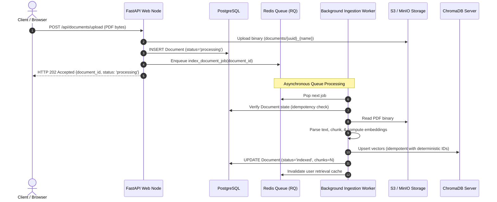

# Distributed Job Queue & Background Ingestion Architecture

## 1. Problem Statement: In-Process vs. Distributed Tasks

In a single-instance development setup, FastAPI's `BackgroundTasks` executes document indexing within the API web process:

```
[Client] --> [FastAPI Process (Uvicorn)]
                 |-- Serves HTTP Requests
                 +-- Runs PDF Parsing & Embedding (Thread)
```

### Critical Limitations of In-Process Tasks Under Scale
1. **Process Coupling & Work Loss**: If the web process restarts (e.g. deployment, OOM kill, unhandled exception), all running and queued background tasks are immediately terminated without state recovery.
2. **Resource Starvation**: PDF parsing and transformer embedding generation are CPU and memory intensive. Running them inside the web process causes high event loop latency and starves incoming HTTP chat requests.
3. **No Horizontal Worker Scaling**: Background work cannot be offloaded to dedicated worker compute instances with GPU acceleration.

---

## 2. Distributed Queue Architecture

The distributed job queue decouples request acceptance from resource-heavy indexing:



---

## 3. Idempotency Guarantees

In distributed systems, networks and message brokers offer **at-least-once delivery**. Transient network errors, worker timeout redeliveries, or user retry clicks can result in duplicate job invocations.

The indexing pipeline enforces multi-layer idempotency:

### Layer 1: Document State Pre-Check
Before invoking parsing or embedding models, the task checks whether the document has already been processed:
```python
document = db.query(Document).filter(Document.id == document_id).first()
if not force_reindex and document.status == "indexed" and (document.chunks or 0) > 0:
    logger.info("Idempotent skip: Document %d already indexed.", document_id)
    return {"document_id": document_id, "status": "indexed", "idempotent_skip": True}
```

### Layer 2: Deterministic Vector Identifiers
All chunks are indexed into ChromaDB with deterministic IDs:
```python
vector_id = f"{document_id}:{chunk_index}"
```
Duplicate upserts overwrite the identical vector IDs in-place without creating duplicate chunk vectors or skewing similarity rankings.

### Layer 3: Stale Vector Cleanup on Reindex or Failure
Before upserting or on caught worker exceptions, any pre-existing vectors for the target `document_id` are purged:
```python
vector_store.delete_by_document_id(document_id)
```

### Layer 4: Mid-Indexing Deletion Resurrection Prevention
If a user deletes a document while worker processing is in flight:
```python
doc_check = db.query(Document).filter(Document.id == document_id).first()
if not doc_check:
    # Document was deleted concurrently
    vector_store.delete_by_document_id(document_id)
    return  # Do not commit 'indexed' status
```

---

## 4. Transactional Outbox Pattern

To prevent scenarios where document metadata commits to PostgreSQL but Redis connection failure loses the queued job, the system supports transactional outbox event logging:

1. **Atomic Write**: In a single database transaction, insert `Document` and append an entry to `outbox_events` table (`event_type="INDEX_DOCUMENT"`).
2. **Relay Dispatcher**: An independent dispatcher process tails the `outbox_events` table and publishes pending events to Redis with retry tracking.
3. **At-Least-Once Delivery**: The outbox entry is marked `published` only after Redis acknowledges receipt.

---

## 5. Failure Recovery & Backpressure

- **Timeout Policy**: Ingestion jobs have an explicit `job_timeout=900` (15 minutes).
- **Worker Crash Leases**: Redis queue job leases automatically expire if a worker node crashes mid-extraction, returning the job to the queue.
- **Max Processing Attempts**: Documents track `processing_attempts`; jobs exceeding 3 attempts are permanently transitioned to `status="failed"` with a sanitized error message.
- **Queue Depth Backpressure**: When queue depth exceeds threshold, API returns HTTP 429 / 503 backpressure, preventing cluster memory exhaustion.
