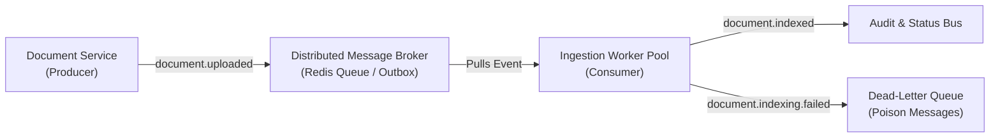
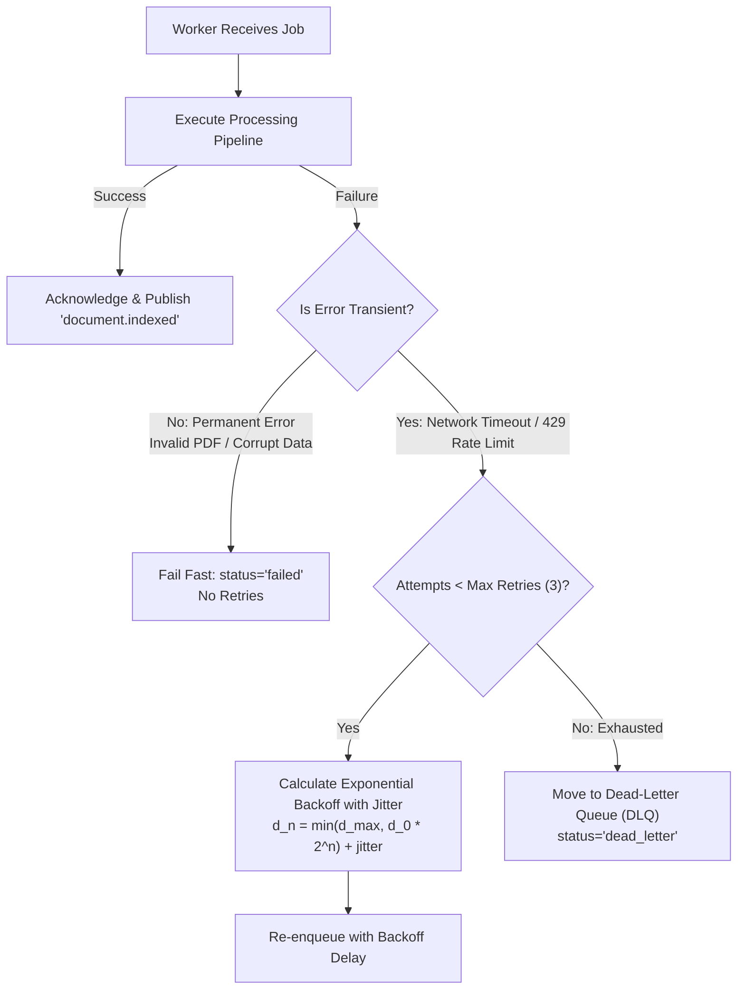

# Distributed Systems & Event-Driven Architecture

## 1. Event-Driven Principles in AI Systems

In a scalable AI Research Assistant, document ingestion, vector retrieval, and status tracking cross multiple physical processes and network boundaries. Rather than tightly coupling API web nodes directly to background workers, the system employs **asynchronous event-driven communication**.



### Commands vs. Events

| Property | Command | Event |
|---|---|---|
| **Semantics** | An imperative request for a component to perform an action. | A factual notification announcing that something has already occurred. |
| **Example** | `IndexDocument(document_id=12)` | `document.uploaded(document_id=12, user_id="u1")` |
| **Coupling** | Producer expects specific downstream execution. | Producer announces facts; consumers react independently. |
| **Failure Handling**| Direct synchronous failure propagation. | Asynchronous retries, leases, and dead-letter queues. |

---

## 2. Core Domain Events

All domain events adhere to standardized, versioned schemas:

| Event Type | Version | Trigger / Condition | Target Consumer Reaction |
|---|---|---|---|
| **`document.uploaded`** | v1 | File saved to S3 and metadata committed to PostgreSQL. | Dispatches background indexing job to worker pool. |
| **`document.indexing.started`** | v1 | Worker successfully acquires atomic processing lock. | Updates document status, logs processing attempt. |
| **`document.indexed`** | v1 | PDF parsed, chunks embedded, and ChromaDB upserted. | Commits `status='indexed'`, invalidates user retrieval caches. |
| **`document.indexing.failed`** | v1 | Parsing or embedding threw unrecoverable error. | Transitions document to `status='failed'`, records sanitized error. |
| **`document.deleted`** | v1 | Document and vectors deleted by authenticated user. | Purges S3 binary, clears user BM25 and retrieval cache. |

---

## 3. Delivery Guarantees & Idempotency

| Delivery Guarantee | Semantics | Practical Limitation in Distributed Systems | System Approach |
|---|---|---|---|
| **At-Most-Once** | Message delivered 0 or 1 time. | Messages can be lost during network drops or worker crashes. | Rejected for document ingestion. |
| **Exactly-Once** | Message delivered and processed exactly 1 time. | Impossibly expensive across heterogeneous systems (Postgres + Redis + ChromaDB). | Theoretical ideal; unsafe without distributed locks. |
| **At-Least-Once** | Message delivered 1 or more times. | Duplicate deliveries can occur. | **Selected Strategy**: Combined with idempotent consumer design. |

### Designing Idempotent Consumers
To safely process at-least-once message streams:
1. **Deterministic Vector IDs**: Vectors are upserted under `f"{document_id}:{chunk_index}"`. Duplicate writes overwrite existing embeddings in-place without vector inflation.
2. **Atomic Status Check**:
   ```sql
   UPDATE documents
   SET status = 'processing', processing_attempts = processing_attempts + 1
   WHERE id = :document_id AND status IN ('uploaded', 'failed', 'processing');
   ```
   If zero rows are updated, duplicate worker deliveries exit immediately with `idempotent_skip=True`.
3. **Resurrection Prevention**: Before committing `status='indexed'`, the worker re-queries document existence. If deleted concurrently, vectors are deleted and no record is resurrected.

---

## 4. Failure Classification & Retry Policies

Not every failure should be retried indefinitely. The system partitions failures into transient and permanent categories:



### Exponential Backoff Formula
$$\text{delay}_n = \min\left(d_{\max},\; d_0 \cdot 2^{n-1}\right) + \text{Uniform}\left(0,\; 0.5 \cdot d_0 \cdot 2^{n-1}\right)$$

Where:
- $d_0 = 1.0\text{ s}$ (initial backoff delay)
- $d_{\max} = 60.0\text{ s}$ (maximum backoff ceiling)
- $\text{Uniform}(...)$ adds jitter to desynchronize concurrent worker retries.

---

## 5. Dead-Letter Queues (DLQ) & Operator Replay

When an outbox event or queue job exceeds its retry budget ($n \ge 3$) or encounters an unhandled fatal condition:
1. It is moved to `status = 'dead_letter'`.
2. The sanitized error message is recorded in `last_error`.
3. The event remains fully inspectable by site reliability engineers.
4. An operator can trigger safe replay via `replay_dead_letter_event(event_id)`, which resets `retry_count = 0` and `status = 'pending'`.

---

## 6. Distributed Tracing & Correlation IDs

Every user action is assigned a correlation ID that propagates across all tiers:

```
[HTTP Request: Header 'X-Correlation-ID: corr_abc123']
       |
       +--> [FastAPI Route]: Logs request with corr_abc123
       |
       +--> [Outbox Event]: Stored with correlation_id = corr_abc123
       |
       +--> [Redis Job]: Enqueued with correlation_id = corr_abc123
       |
       +--> [Worker Execution]: Logs PDF parsing & embedding with [Corr: corr_abc123]
       |
       +--> [ChromaDB & SQL]: Audit records preserve corr_abc123
```

> [!IMPORTANT]
> Trace attributes and event payloads **never** store raw passwords, JWT tokens, Gemini API keys, or private extracted document text.
