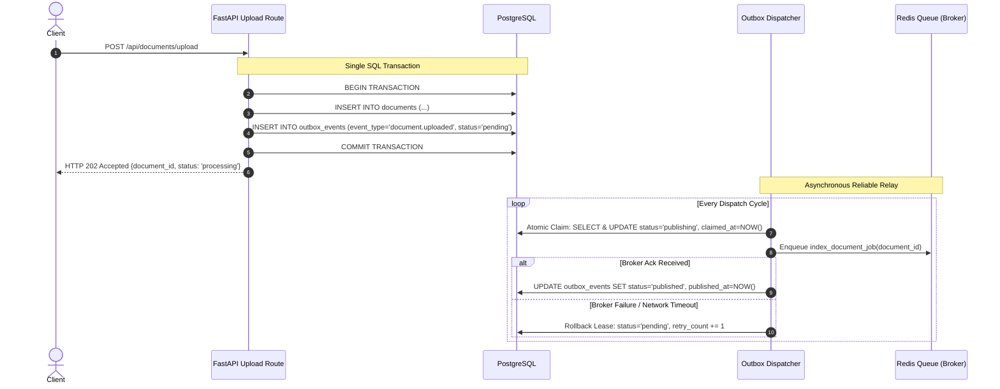

# The Transactional Outbox Pattern

## 1. The Dual-Write Problem

In a distributed service architecture, a single user request often requires updating a relational database and publishing a message to a queue:

```python
# The Dual-Write Anti-Pattern
db.add(document)
db.commit()  # SQL succeeds!

queue.enqueue("index_document_job", document.id)  # Redis network failure!
```

### The Inconsistency Window
1. **Case A (Database First)**: The database transaction commits successfully. Before or during queue enqueueing, the Redis broker crashes or network drops. The document remains stuck in `status='processing'`, but no worker ever receives the job.
2. **Case B (Queue First)**: If the queue enqueueing occurs before `db.commit()`, a fast worker may pop the job from Redis and query PostgreSQL before the transaction finishes committing, causing `Document not found` errors.

This fundamental distributed systems dilemma is known as the **dual-write problem**. Without two-phase commit (2PC) or distributed consensus, writing to two independent stateful systems cannot be atomic.

---

## 2. Transactional Outbox Architecture

The Transactional Outbox pattern eliminates the dual-write failure window by persisting both the domain entity (`Document`) and the outbound event (`OutboxEvent`) in the **exact same ACID database transaction**:



If the database transaction aborts, neither the document nor the outbox event is persisted. If Redis is temporarily unreachable, the outbox event remains safely recorded in PostgreSQL until connectivity is restored.

---

## 3. Database Schema: `outbox_events`

The `outbox_events` table is managed via Alembic migrations:

```sql
CREATE TABLE outbox_events (
    id VARCHAR PRIMARY KEY,
    event_type VARCHAR NOT NULL,
    event_version INTEGER NOT NULL DEFAULT 1,
    aggregate_id VARCHAR NOT NULL,
    correlation_id VARCHAR,
    payload TEXT NOT NULL,
    status VARCHAR NOT NULL DEFAULT 'pending',
    retry_count INTEGER NOT NULL DEFAULT 0,
    max_retries INTEGER NOT NULL DEFAULT 3,
    last_error TEXT,
    claimed_at DATETIME,
    published_at DATETIME,
    created_at DATETIME NOT NULL,
    updated_at DATETIME NOT NULL
);

CREATE INDEX ix_outbox_events_status_created ON outbox_events (status, created_at);
```

---

## 4. The Concurrent Dispatcher Problem & Atomic Leases

In horizontally scaled deployments, multiple dispatcher instances or worker processes run simultaneously. If two dispatchers query `status='pending'` concurrently, both could attempt to publish the same event.

### Atomic Claim & Lease Expiration Mechanism
The `OutboxDispatcher` acquires an exclusive short-lived lease before publishing:

```python
# 1. Fetch pending events or expired leases
candidates = (
    db.query(OutboxEvent)
    .filter(
        (OutboxEvent.status == "pending")
        | (
            (OutboxEvent.status == "publishing")
            & (OutboxEvent.claimed_at < now - lease_timeout)
        )
    )
    .order_by(OutboxEvent.created_at.asc())
    .limit(batch_size)
    .all()
)

# 2. Atomically transition to 'publishing'
for event in candidates:
    event.status = "publishing"
    event.claimed_at = now
db.commit()
```

### Stale Lease Recovery
If a dispatcher process crashes after claiming an event but before publishing, the lease timestamp `claimed_at` will eventually exceed `lease_timeout_seconds` (default: 300 s). On the next dispatch loop, any surviving dispatcher reclaims the stale event and completes the delivery.

---

## 5. Verification Under Failure Scenarios

| Test Scenario | Injected Condition | Expected System Behavior | Verification Status |
|---|---|---|---|
| **SQL Failure** | Intentional rollback during document creation. | Neither `Document` nor `OutboxEvent` persists; zero orphaned records. | Verified |
| **Broker Outage** | Redis unreachable during upload request. | Outbox event stays in `status='pending'`; retried on recovery without losing jobs. | Verified |
| **Dispatcher Crash** | Dispatcher crashes after publishing before marking `published`. | Lease expires; duplicate delivery safely absorbed by idempotent task. | Verified |
| **Two Workers Race** | Two workers simultaneously pop the same document job. | Atomic SQL update claims row once; duplicate worker skips with `idempotent_skip=True`. | Verified |
| **Exhausted Retries** | Persistent network failure exceeding 3 attempts. | Event transitions to `status='dead_letter'` with sanitized error message; inspectable and replayable. | Verified |
