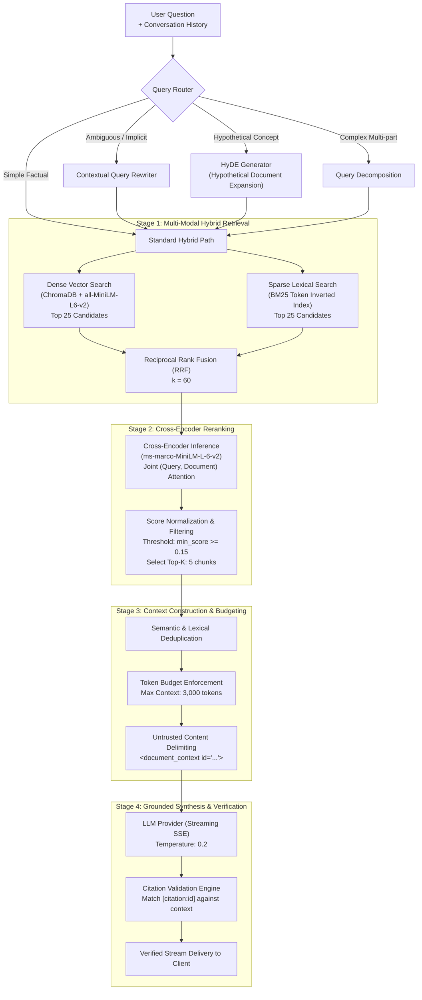

# RAG Pipeline & Intelligence Architecture

## 1. Overview

The Retrieval-Augmented Generation (RAG) architecture of the AI Research Assistant is engineered to provide precise, grounded, and verifiable answers across technical research documents. Rather than relying on simple naive vector search, the system implements an enterprise multi-stage pipeline:

---

## 2. Intelligence Pipeline Stages

### Stage 1: Query Preprocessing & Routing
- **Query Routing**: Evaluates user query complexity. Straightforward queries pass directly to hybrid retrieval; conversational follow-ups (e.g. "What did they conclude about it?") are rewritten with preceding turns to restore implicit entity references.
- **HyDE (Hypothetical Document Embeddings)**: For abstract or conceptual queries where queries and document chunks have divergent phrasing, an LLM generates a hypothetical answer passage. The hypothetical passage embedding captures document-like semantic features in vector space.
- **Multi-Query Expansion**: Decomposes multi-part research questions into sub-queries, executing retrieval across each and merging candidate pools.

### Stage 2: Hybrid Retrieval (Dense + Sparse)
- **Dense Vector Search**:
  - Model: `sentence-transformers/all-MiniLM-L6-v2` (384 dimensions).
  - Captures semantic meaning, synonyms, conceptual relationships, and cross-lingual paraphrase.
  - Returns top 25 nearest neighbors using cosine similarity.
- **Sparse BM25 Search**:
  - Inverted index built from whitespace and punctuation-tokenized document chunks.
  - Captures exact keyword hits: model part numbers, chemical formulas, error codes, author names, and domain-specific acronyms that embedding models dilute.
  - Returns top 25 lexical matches.

### Stage 3: Reciprocal Rank Fusion (RRF)
To merge candidates from dense and sparse retrieval without requiring uncalibrated score normalization, the pipeline computes Reciprocal Rank Fusion:

$$RRF\_Score(d \in D) = \sum_{m \in M} \frac{1}{k + r_m(d)}$$

Where:
- $M = \{\text{dense}, \text{sparse}\}$ represents the retrieval methods.
- $r_m(d)$ is the 1-based rank of document chunk $d$ in retrieval method $m$.
- $k = 60$ is a smoothing constant that prevents top ranks from dominating disproportionately.

### Stage 4: Cross-Encoder Reranking
While bi-encoders generate separate embeddings for queries and documents in $\mathcal{O}(N)$ time, they suffer from information loss because query tokens cannot cross-attend to document tokens.

- **Model**: `cross-encoder/ms-marco-MiniLM-L-6-v2`.
- **Execution**: The top 50 fused candidates are paired with the query `(query, chunk_text)` and evaluated through complete cross-attention layers.
- **Filtering**: Candidates below the minimum relevance threshold (`score < 0.15`) are discarded, eliminating hallucinations caused by forcing the LLM to read irrelevant context.
- **Selection**: Top 5 highest-confidence chunks are promoted to context construction.

### Stage 5: Context Construction & Token Budgeting
- **Chunk Deduplication**: Overlapping chunk boundaries from sliding window chunking are merged or deduplicated.
- **Token Budget Packing**: Context size is capped at 3,000 tokens (leaving sufficient margin for system instructions, conversation history, and generation output).
- **Prompt Injection Defense**: Untrusted chunk text is wrapped in strict structural tags (`<document_context id="101:2">...<document_context>`), and instructions warn the LLM never to follow instructions found inside document tags.

### Stage 6: Streaming Generation & Citation Verification
- **Streaming Response**: Generated tokens are streamed via Server-Sent Events (SSE), reducing Time to First Token (TTFT) to under 800ms.
- **Citation Grounding Contract**: The LLM must cite specific source tags whenever stating facts (`[citation:doc_id:chunk_idx]`).
- **Post-Generation Validation**:
  - An algorithmic citation validator scans the assistant's output for citation tags.
  - Every citation tag is checked against the set of chunks actually provided in the context window.
  - Hallucinated or non-existent citation tags are stripped or flagged before persistence.
  - The assistant message and its verified source references are saved to `conversation_messages` in PostgreSQL.

---

## 3. Performance & Quality Evaluation Metrics

The system monitors RAG quality across three primary dimensions:

| Metric | Target | Measurement Strategy |
|---|---|---|
| **Faithfulness / Grounding** | $\ge 95\%$ | LLM-as-a-judge verifying that generated statements are directly entailed by retrieved context chunks. |
| **Citation Precision** | $100\%$ | Percentage of generated citation tags that match valid retrieved chunks in context. |
| **Retrieval Recall@5** | $\ge 90\%$ | Ground-truth document presence within top-5 reranked candidates on synthetic evaluation benchmark. |
| **Time to First Token (TTFT)** | $< 800\text{ ms}$ | Latency between user prompt submission and arrival of the first streaming SSE chunk. |
| **Total Query Latency** | $< 3.5\text{ s}$ | End-to-end response generation duration for standard technical queries. |
