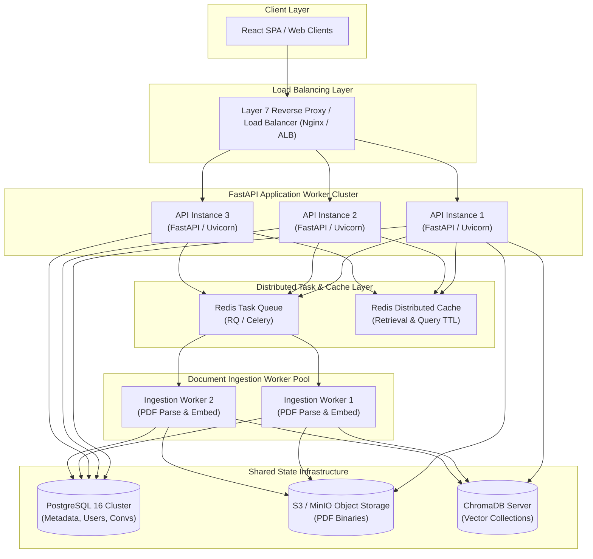

# Scalability & Horizontal Architecture

## 1. Vertical vs. Horizontal Scaling

As the AI Research Assistant scales to handle concurrent users and higher document ingestion throughput, system architecture must evolve from single-node execution to a horizontally distributed system.



### Architectural Trade-offs

| Strategy | Description | Advantages | Limitations |
|---|---|---|---|
| **Vertical Scaling** | Scaling up CPU, RAM, or NVMe storage on a single server. | Zero code changes; no distributed systems complexity or network partitions. | Hardware ceiling; single point of failure (SPOF); costly high-tier hardware. |
| **Horizontal Scaling** | Adding stateless application workers behind a load balancer. | Elastic scaling with demand; isolated worker crashes; high fault tolerance. | Requires externalizing all state into shared databases, caches, and queues. |

---

## 2. Elimination of Process-Local State

In a horizontally scaled deployment, user requests may hit different worker instances sequentially (e.g. upload document on API-1, check status on API-2, query chat on API-3). Process-local state (`active_jobs = {}`, `conversation_cache = {}`, local disk files) causes state fragmentation, ghost jobs, and cache inconsistency.

### Shared State Placement Matrix

| State Type | Previous Local Form | Target Distributed Location | Rationale & Consistency Guarantee |
|---|---|---|---|
| **User Accounts & Credentials** | SQLite file | **PostgreSQL** | ACID transactions, unique constraints, bcrypt hashes. |
| **Document Metadata & Status** | SQLite file | **PostgreSQL** | Strict relational foreign keys, row-level locking, MVCC. |
| **Conversations & Message Logs** | SQLite file | **PostgreSQL** | Append-only conversation history with indexed lookups. |
| **Background Indexing Jobs** | Python `threading` / `BackgroundTasks` | **Redis Queue (RQ)** | Persistent job persistence across API restarts; distributed worker pool. |
| **Candidate Retrieval Cache** | In-memory `OrderedDict` | **Redis Cache** | Shared across all API nodes; user-isolated deterministic key hashing. |
| **Uploaded PDF Binaries** | Local disk `uploads/` | **S3 / MinIO Object Storage** | Globally accessible by all API instances and ingestion workers. |
| **Dense Vector Embeddings** | Local disk `./document_db` | **ChromaDB Server Mode** | Shared collection access for vector search and worker upserts. |
| **Configuration & Secrets** | Hardcoded `.env` | **Environment / Vault** | Centralized configuration validated at container startup. |

---

## 3. Database Connection Pooling with PostgreSQL

SQLite relies on filesystem locks where concurrent write requests block or fail with `database is locked`. PostgreSQL provides Multi-Version Concurrency Control (MVCC) and robust row-level locking.

### Connection Budget Formula

When multiple application workers run concurrently, the database connection pool must be budgeted to prevent exhausting PostgreSQL `max_connections`:

$$C_{\max} = W \times (P + O) + S$$

Where:
- $W$ = Number of application worker processes.
- $P$ = `pool_size` (baseline persistent connections maintained per worker).
- $O$ = `max_overflow` (temporary burst connections per worker under load).
- $S$ = Reserved connections for background workers, migration tools, and DB administration.

### Example Sizing Calculation

Given a cluster with 4 FastAPI workers and 2 background ingestion workers:
- Per-worker baseline pool: $P = 10$
- Per-worker overflow burst: $O = 5$
- Total API peak connections: $4 \times (10 + 5) = 60$
- Ingestion worker connections: $2 \times 5 = 10$
- System reserved headroom: $10$
- **Total required PostgreSQL `max_connections`**: $\ge 80$ connections.

### Engine Configuration

```python
engine = create_engine(
    DATABASE_URL,
    pool_size=settings.db_pool_size,       # default 10
    max_overflow=settings.db_max_overflow, # default 5
    pool_timeout=settings.db_pool_timeout, # default 30s
    pool_pre_ping=settings.db_pool_pre_ping,# validates alive connections
)
```

---

## 4. Distributed Failure Modes & Resilience Matrix

| Dependency Failure | Failure Scenario | System Impact | Required Architectural Response |
|---|---|---|---|
| **Redis Queue Down** | Broker offline or network partitioned | New uploads cannot be enqueued | Fall back safely to synchronous/local queue or return explicit 503; do not drop user upload silently. |
| **Worker Crash Mid-Job** | Memory spike during PDF extraction kills worker | Job left unfinished in queue | Queue leases expire; job returned to queue; processing attempt incremented. |
| **Duplicate Delivery** | Network hiccup causes queue double-delivery | Job executed twice by workers | **Idempotent job execution**: status checks (`status == "indexed"`) and stable vector IDs skip duplicate work. |
| **PostgreSQL Down** | Database primary node failover | API requests cannot read/write | Return controlled 503 Service Unavailable; health check marks node unready. |
| **Object Storage Down** | S3 bucket unreachable | File cannot be saved or read | Fail upload transaction immediately; never return false 200 upload success. |
| **ChromaDB Down** | Vector server unreachable | Semantic retrieval fails | Graceful fallback to keyword retrieval or honest abstention without hallucinating citations. |
| **Queue Backpressure** | Ingestion requests exceed worker throughput | Queue depth and wait time grow | Monitor queue depth; apply rate limits; autoscale background worker instances. |

---

## 5. Monitoring & Operational Signals

Distributed architectures require metrics beyond single-process CPU and memory:
1. **Queue Depth**: Number of pending jobs in `document-indexing`.
2. **Oldest Job Age**: Seconds elapsed since the oldest pending job was enqueued.
3. **Database Pool Utilization**: Active vs idle connections across all workers.
4. **Redis Memory & Eviction Count**: Tracking cache saturation.
5. **ChromaDB Query Latency**: P95 and P99 latency for vector searches.
