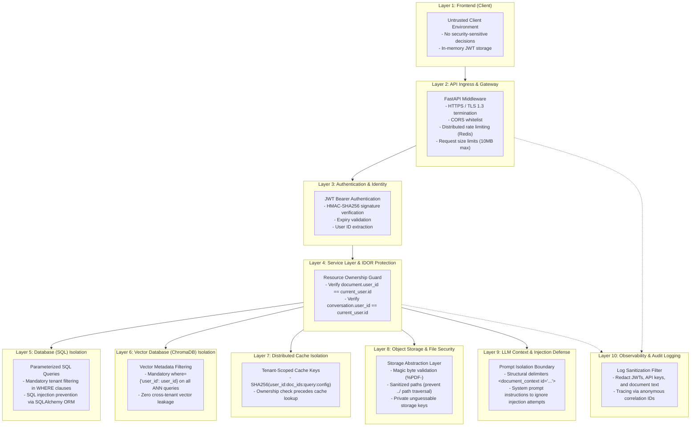

# Security Architecture & Threat Modeling

## 1. Zero-Trust Security Philosophy

The AI Research Assistant operates on a **zero-trust, defense-in-depth** security model. The fundamental architectural invariant of the system is:

> **Core Security Invariant**: No operation involving a user's data can be authorized solely because the client supplied a valid-looking ID. Every request must authenticate identity, verify resource ownership, and validate data boundaries at every layer.

### Distinguishing Core Security Concepts

| Concept | Question Answered | Where Enforced | Implementation |
|---|---|---|---|
| **Authentication** | *Who are you?* | API Gateway / Middleware | Stateless JWT verification, signature validation, expiry checks (`exp`). |
| **Authorization** | *Are you permitted to access this specific entity?* | Application Service / SQL layer | Tenant ownership checks (`WHERE id = :id AND user_id = :auth_user_id`). |
| **Data Validation** | *Is this input safe, well-formed, and compliant?* | Route schemas / Ingestion worker | Pydantic model validation, file magic byte verification, token length limits. |

---

## 2. Multi-Layer Defense-in-Depth

---

## 3. Layer-by-Layer Security Controls

| Layer | Threat Mitigated | Enforced Control |
|---|---|---|
| **1. Frontend** | Client tampering, token theft | Client is strictly untrusted. JWT tokens are stored securely in memory; authorization is never decided on client-side state. |
| **2. API Ingress** | DoS, brute force, oversized payloads | Redis sliding-window rate limiting (e.g. 60 req/min), CORS restricted to authorized frontend origins, max upload body capped at 10MB. |
| **3. Authentication** | Spoofing, session hijacking | JWT bearer tokens signed with high-entropy secret (`HS256`), checked for expiration, revoked on password reset. |
| **4. Service Layer** | IDOR (Insecure Direct Object Reference) | Every retrieval, update, or deletion operation validates that `entity.user_id == authenticated_user.id`. |
| **5. SQL Database** | SQL Injection, data leakage | SQLAlchemy parameterized queries; all tenant operations scoped by foreign keys with cascading cleanup. |
| **6. Vector Store** | Cross-tenant semantic leakage | ChromaDB queries explicitly mandate `where={"user_id": current_user.id}`. Chunks from user A are never returned to user B. |
| **7. Distributed Cache** | Cache poisoning, cross-tenant cache hit | Cache keys incorporate hashed `user_id` and document IDs. A user can only hit a cache entry populated by their own query. |
| **8. File Storage** | Malware upload, path traversal | Magic byte inspection verifies genuine `%PDF-` signature; filenames are sanitized; files are stored under private UUID keys. |
| **9. LLM Context** | Indirect prompt injection, jailbreaks | Document content is strictly treated as untrusted text, wrapped in `<document_context>` XML tags with explicit anti-jailbreak system prompts. |
| **10. Observability** | Credential exposure, PII leakage | Structured JSON logs filter out sensitive headers, passwords, JWT tokens, and raw document chunks. |

---

## 4. Threat Model Summary (STRIDE Matrix)

| STRIDE Category | Potential Threat | Applied Countermeasure | Verification Test |
|---|---|---|---|
| **Spoofing** | Attacker impersonates another user via forged token | Cryptographic JWT signature verification (`decode_access_token`) | `test_auth_invalid_token_rejected` |
| **Tampering** | Malicious file disguised as PDF uploaded to server | Magic byte inspection (`%PDF-`), reject disguised executables/scripts | `test_upload_invalid_magic_bytes_rejected` |
| **Repudiation** | User denies performing document deletion or action | Distributed tracing with correlation IDs and immutable outbox audit logs | `test_outbox_event_audit_trail` |
| **Information Disclosure** | User queries document chunks belonging to another researcher | Multi-tenant isolation at SQL, ChromaDB, and Redis cache layers | `test_user_isolation_document_and_vector` |
| **Denial of Service** | Ingestion worker crashed by poisoned, infinite-loop PDF | Worker timeout limits (900s), memory guards, and Dead-Letter Queue routing | `test_poison_pill_dead_letter_routing` |
| **Elevation of Privilege** | User manipulates document ID parameter in delete request | Mandatory tenant ownership filter (`WHERE id=:id AND user_id=:uid`) | `test_idor_document_deletion_forbidden` |
