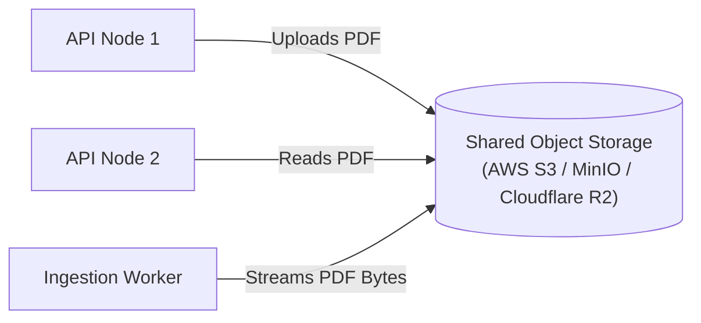

# Shared Object Storage Architecture

## 1. Limitations of Local Filesystem Storage

In a single-worker architecture, uploaded files reside in the local directory `backend/uploads/`. When transitioning to a horizontally scaled deployment with multiple API instances and background ingestion workers:

```
[API Worker 1 (Host A)] ----> writes to Local Disk A: /uploads/doc_1.pdf
[API Worker 2 (Host B)] ----> CANNOT ACCESS Local Disk A
[Worker Node (Host C)]  ----> CANNOT READ /uploads/doc_1.pdf
```

If an upload lands on API Worker 1, subsequent read requests routed by the load balancer to API Worker 2 or background processing routed to Worker Node 3 fail with `FileNotFoundError`.

---

## 2. Shared Object Storage Model

All persistent binary document files are decoupled from compute nodes and placed in shared, S3-compatible object storage:



### Supported Storage Targets
1. **AWS S3**: Managed enterprise object storage with versioning, SSE-S3 / SSE-KMS encryption, and cross-region replication.
2. **MinIO**: High-performance, self-hosted, S3-compatible object storage ideal for on-premise or local development clusters.
3. **Cloudflare R2**: S3-compatible storage with zero egress fee bandwidth.

---

## 3. Storage Abstraction Layer

To avoid tight coupling between business logic and proprietary cloud SDKs, storage operations are mediated through the abstract `Storage` interface:

```python
class Storage(ABC):
    @abstractmethod
    def save(self, filename: str, content: bytes) -> str:
        """Upload document bytes and return stable storage URI / key."""
        pass

    @abstractmethod
    def read(self, file_path: str) -> bytes:
        """Retrieve binary document content by storage path / key."""
        pass

    @abstractmethod
    def exists(self, file_path: str) -> bool:
        """Check whether object exists in storage."""
        pass

    @abstractmethod
    def delete(self, file_path: str) -> None:
        """Purge document object from storage."""
        pass
```

### Factory Resolution
The storage implementation is dynamically resolved via `backend/storage/factory.py` based on `settings.storage_type`:
- `storage_type == "local"`: `LocalStorage(base_path=settings.storage_path)`
- `storage_type == "s3"`: `S3Storage(bucket_name=settings.s3_bucket_name, endpoint_url=settings.s3_endpoint_url, ...)`

---

## 4. Security, Key Naming, & Tenant Isolation

### Deterministic & Collusion-Free Key Naming
Uploaded files are never saved under raw user-supplied filenames (which would expose the system to path traversal and name collisions). Instead, object keys use server-generated cryptographically secure UUID prefixes with sanitized basenames:

```python
clean_name = Path(filename).name or "document.pdf"
key = f"documents/{uuid.uuid4()}_{clean_name}"
```

### Protection Against Credential & URL Leakage
- **No Direct Public URLs**: Raw S3 bucket URLs are never exposed to the frontend browser or returned in public API payloads.
- **Controlled Streaming Proxy**: All document downloads or chunk inspections are authenticated by FastAPI via JWT authorization tokens and served through a streaming response.
- **Signed URLs for Direct Uploads (Optional)**: If large file uploads (>50 MB) bypass the API tier in future iterations, time-limited presigned S3 PUT URLs will be generated strictly after user authentication and quota verification.

---

## 5. Storage Integrity & Validation

Before persisting any binary payload to shared storage:
1. **Size Verification**: Enforces `settings.max_upload_size_mb` (HTTP 413 Payload Too Large).
2. **Magic Byte Signature**: Validates binary header contains `%PDF-` signature (`has_pdf_signature`), preventing malicious executable uploads.
3. **SHA-256 Content Hashing**: Calculates deterministic content digest (`file_hash`) to deduplicate uploads and verify vector store parity.
4. **Cleanup on Failure**: If metadata creation or database commit fails, newly written storage objects are purged to maintain zero orphaned files.
