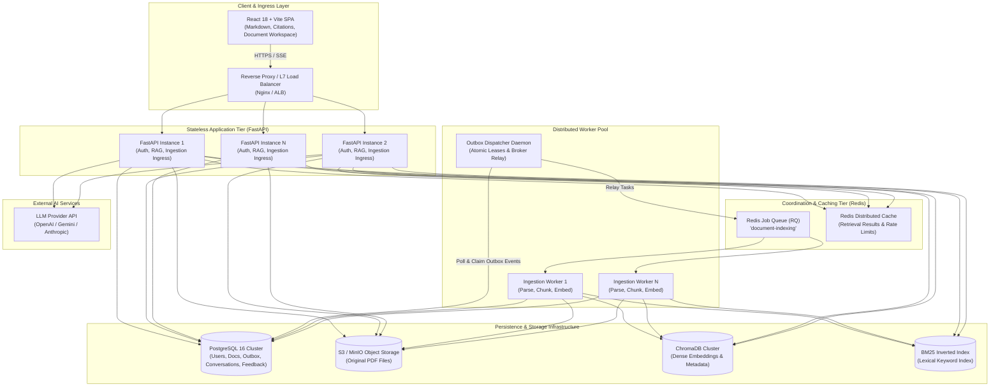

# System Overview & High-Level Architecture

## 1. System Mission & Scope

The **AI Research Assistant** is an end-to-end, enterprise-grade Retrieval-Augmented Generation (RAG) platform. It allows knowledge workers and researchers to upload dense technical PDF documents, automatically index and extract knowledge, perform semantic and lexical research queries, explore source citations with document previews, maintain contextual conversations, and provide iterative feedback.

Rather than treating RAG as a simple script connecting a vector database to an LLM API, this platform implements a resilient, horizontally scalable, multi-tenant distributed system built to withstand real-world operational challenges: network partitions, provider rate limits, poisoned documents, concurrent workers, and tenant isolation requirements.

---

## 2. Requirements Specification

### Functional Requirements

| Category | Requirement | Architectural Implementation |
|---|---|---|
| **Identity & Access** | User registration, login, and secure authentication | Stateless JWT bearer tokens, bcrypt password hashing, token expiration and refresh handling. |
| **Document Management** | PDF upload, validation, lifecycle tracking, deletion, and re-indexing | Magic-byte format verification, SHA-256 deduplication, S3/local storage abstraction, transactional outbox status tracking. |
| **Ingestion Pipeline** | Background text extraction, chunking, embedding generation, and multi-index upsert | Asynchronous worker pool, PyPDF/pdfplumber parsing, RecursiveCharacterTextSplitter, dense ChromaDB embeddings, BM25 sparse index. |
| **Hybrid Retrieval** | Semantic and keyword search across user-scoped document corpora | Vector similarity (dense) combined with BM25 (sparse) through Reciprocal Rank Fusion (RRF). |
| **Reranking** | High-precision candidate relevance scoring | Cross-encoder inference (`ms-marco-MiniLM-L-6-v2`) re-scoring fused retrieval candidates. |
| **Contextual QA** | Context-aware LLM answer synthesis with strict grounding | Conversation history memory, token budget management, system prompt delimiters, streaming response delivery. |
| **Attribution & Transparency** | Source citations with exact chunk provenance and inline previews | Structured citation references mapped to document IDs, page numbers, chunk offsets, and text previews. |
| **Memory & History** | Stateful multi-turn research conversations | SQL-persisted conversation and message entities scoped strictly to the authenticated user. |
| **Evaluation & Feedback** | User feedback collection and RAG quality evaluation | Explicit user ratings (thumbs up/down + feedback text) stored in SQL for offline evaluation and retrieval tuning. |

### Non-Functional Requirements

| Quality Attribute | Engineering Requirement | Architectural Strategy |
|---|---|---|
| **Security** | Zero-trust tenant isolation and defense-in-depth | Hard boundaries at API, SQL, vector, storage, and cache layers. All queries enforce `user_id`. No client ID trust. |
| **Reliability** | Fault-tolerant processing with zero message loss | Transactional Outbox pattern, idempotent job claims, transient vs. permanent error classification, exponential backoff with jitter. |
| **Scalability** | Horizontal scaling across API and ingestion nodes | Stateless FastAPI instances behind Layer 7 load balancer; independent worker pool autoscaling based on queue depth. |
| **Performance** | Sub-second retrieval and streaming time-to-first-token (TTFT) | Two-tier caching (Redis retrieval cache + in-memory embedding cache), batch vector operations, Server-Sent Events (SSE). |
| **Maintainability** | Modular cohesion with explicit service contracts | Clean architecture separating route handlers, services, repositories, and worker tasks. Centralized Pydantic Settings. |
| **Observability** | End-to-end auditability and distributed tracing | Structured JSON logging, correlation ID propagation across HTTP headers, outbox events, and worker jobs, health probes (`/health/live`, `/health/ready`). |
| **Data Integrity** | ACID guarantees and schema evolution | Relational metadata in PostgreSQL, versioned Alembic migrations, atomic status transitions, coordinated cascade deletions. |

---

## 3. High-Level Architecture Topology

---

## 4. Component Responsibilities

| Component | Technology | Primary Responsibilities | State Classification |
|---|---|---|---|
| **Frontend** | React 18, Vite, TailwindCSS | User interface, state management, citation previewing, chat streaming render via SSE. | Ephemeral / Client-side |
| **API Gateway / App Server** | FastAPI, Uvicorn, Pydantic | HTTP request routing, JWT validation, rate limiting, RAG pipeline orchestration, health checks. | **Stateless** |
| **Authentication Service** | Passlib (bcrypt), PyJWT | Password hashing, token generation/verification, user identity claims. | Stateless logic |
| **Operational Database** | PostgreSQL 16 (or SQLite in dev) | Authoritative source of truth for users, documents, conversations, messages, feedback, and outbox events. | **Persistent ACID** |
| **Object Storage** | AWS S3 / MinIO / Local FS | Immutable binary storage for uploaded PDF files with tenant-isolated key paths. | **Persistent Object** |
| **Vector Database** | ChromaDB (Client-Server / Persistent) | Storage and approximate nearest neighbor (ANN) retrieval for dense vector embeddings. | **Persistent Index** |
| **Sparse Index** | BM25 (rank-bm25 / inverted index) | Term frequency / inverse document frequency lexical retrieval for exact terminology matches. | Persistent Index |
| **Rank Fusion** | Reciprocal Rank Fusion (RRF) | Merges ranked lists from dense and sparse retrieval using rank-based reciprocal scoring. | Stateless Compute |
| **Reranker** | Cross-Encoder (`ms-marco-MiniLM-L-6-v2`) | Joint query-document relevance scoring to eliminate false positives prior to LLM context construction. | Stateless Compute |
| **Distributed Broker & Cache** | Redis 7 | Background task queue broker, distributed retrieval result cache, distributed rate limiting. | In-Memory / Ephemeral |
| **Outbox Dispatcher** | Standalone Python Process | Guaranteed at-least-once relay of outbox events from SQL to Redis broker with lease locking. | Worker Daemon |
| **Background Ingestion Workers** | Python Worker Processes (RQ) | PDF text extraction, recursive semantic chunking, embedding generation, index population. | Worker Compute |
| **LLM Provider** | OpenAI / Gemini / Ollama API | Context synthesis, answer generation, structured citation referencing. | External Service |
| **Database Migrations** | Alembic | Version-controlled, deterministic schema evolution and rollback management. | Operational Tool |
| **Observability** | OpenTelemetry, Prometheus, Logging | Distributed tracing, correlation ID tracking, metrics, and health observability. | Infrastructure |

---

## 5. Architectural Style: Modular Monolith with Distributed Workers

### Why Modular Monolith?
Rather than fragmenting this system into dozens of microservices (e.g., auth service, ingestion service, retrieval service, chat service, citation service), the application is organized as a **modular monolith** with **decoupled background workers**.

1. **Elimination of Distributed Failure Modes**: In-process calls between auth, document services, and retrieval avoid network hops, serialization overhead, distributed transactions, and partial network partitions.
2. **Operational Simplicity**: A single deployable codebase with shared models, centralized configuration, and unified migration management.
3. **Targeted Scalability**: The computationally expensive components (PDF parsing, embedding generation, reranking) are decoupled into independently scalable background worker processes via Redis, while the FastAPI web tier scales independently based on HTTP traffic.
4. **Clean Service Boundaries**: Internal modules communicate through explicit service boundaries (`services/document_processor.py`, `services/retrieval_cache.py`, `services/rag_service.py`), allowing any module to be extracted into a standalone microservice in the future if organizational or scaling requirements demand it.
