# AWS Cloud Architecture Specification

## 1. Executive Summary & Architectural Vision

This document details the production cloud infrastructure for the **AI Research Assistant** on Amazon Web Services (AWS). Building on our containerization and Kubernetes foundations, this architecture translates logical components into managed, highly available, secure, and cost-effective cloud services.

### AWS Well-Architected Framework Alignment

| Pillar | Architectural Implementation |
|---|---|
| **Operational Excellence** | Infrastructure as Code (Terraform), centralized logging (CloudWatch Logs), distributed tracing (OpenTelemetry / AWS X-Ray), automated CI/CD deployments via GitHub Actions OIDC. |
| **Security** | Zero-trust network segmentation (3-tier VPC), IAM workload identities (ECS Task Roles / EKS IRSA), KMS customer-managed encryption at rest, TLS 1.3 in transit, private S3 with Origin Access Control (OAC). |
| **Reliability** | Multi-AZ redundancy (2 Availability Zones), RDS automated failover, dead-letter queues (SQS DLQ), health-gated rolling updates, multi-system backup reconciliation. |
| **Performance Efficiency** | ElastiCache Redis distributed retrieval caching, CloudFront global edge CDN, S3 presigned URL downloads, right-sized compute tasks. |
| **Cost Optimization** | S3 Intelligent-Tiering, Gateway VPC Endpoints for S3 (free of data processing fees), auto-scaled worker pools, AWS Budgets with proactive alerting. |
| **Sustainability** | Serverless compute (AWS Fargate) minimizing idle EC2 provisioning, Graviton (ARM64) processor adoption where supported. |

---

## 2. High-Level AWS Architecture Topology

```mermaid
flowchart TD
    subgraph EdgeLayer ["Edge & DNS Layer (Global)"]
        User["User Browser / Client"]
        Route53["Amazon Route 53<br/>(DNS Routing & Health Checks)"]
        CloudFront["Amazon CloudFront CDN<br/>(Edge Caching & SSL Termination)"]
        ACM["AWS Certificate Manager (ACM)<br/>(Public & Private TLS Certs)"]
    end

    subgraph AWSCloud ["AWS Region (e.g. us-east-1)"]
        subgraph VPC ["Amazon VPC (10.0.0.0/16) - 2 Availability Zones"]

            subgraph PublicSubnets ["Public Subnets (AZ-A: 10.0.1.0/24 | AZ-B: 10.0.2.0/24)"]
                ALB["Application Load Balancer (ALB)<br/>(api.example.com)"]
                NATGatewayA["NAT Gateway AZ-A"]
                NATGatewayB["NAT Gateway AZ-B"]
            end

            subgraph PrivateAppSubnets ["Private Application Subnets (AZ-A: 10.0.11.0/24 | AZ-B: 10.0.12.0/24)"]
                FastAPICluster["FastAPI API Service<br/>(ECS Fargate / EKS Pods)<br/>Stateless, Autoscaled"]
                WorkerPool["Background Ingestion Workers<br/>(ECS Fargate / EKS Pods)<br/>PDF Parse, Chunk, Embed"]
            end

            subgraph IsolatedDataSubnets ["Isolated Data Subnets (AZ-A: 10.0.21.0/24 | AZ-B: 10.0.22.0/24)"]
                RDSPrimary[("Amazon RDS PostgreSQL<br/>(Primary - AZ-A)")]
                RDSStandby[("Amazon RDS PostgreSQL<br/>(Sync Standby - AZ-B)")]
                ElastiCacheRedis[("Amazon ElastiCache Redis<br/>(Cluster / Multi-AZ)")]
                ChromaDBCluster[("ChromaDB Vector Store<br/>(Self-Managed on ECS/EBS)")]
            end

            subgraph VPCEndpoints ["VPC Endpoints (PrivateLink & Gateway)"]
                S3Endpoint["S3 Gateway Endpoint (Free)"]
                ECREndpoint["ECR API/Docker Interface Endpoint"]
                SecretsEndpoint["Secrets Manager Interface Endpoint"]
                CWEndpoint["CloudWatch Logs Interface Endpoint"]
            end
        end

        subgraph ManagedAWS ["Managed AWS Services"]
            S3Frontend["Amazon S3 Bucket<br/>(Frontend Static SPA - Private)"]
            S3Documents["Amazon S3 Bucket<br/>(PDF Storage - SSE-KMS)"]
            SQSQueue["Amazon SQS Task Queue<br/>('document-indexing')"]
            SQSDLQ["Amazon SQS Dead-Letter Queue<br/>('indexing-dlq')"]
            ECRRegistry["Amazon Elastic Container Registry (ECR)<br/>(Backend & Frontend Images)"]
            SecretsManager["AWS Secrets Manager<br/>(DB, JWT, LLM Keys)"]
            CloudWatch["Amazon CloudWatch<br/>(Logs, Metrics, Alarms)"]
        end
    end

    subgraph ExternalServices ["External AI Providers"]
        ExternalLLM["LLM Provider API<br/>(Gemini / OpenAI / Anthropic)"]
    end

    User --> Route53
    Route53 -->|app.example.com| CloudFront
    Route53 -->|api.example.com| ALB

    CloudFront -->|Origin Access Control| S3Frontend
    ALB -->|HTTPS Target Group| FastAPICluster

    FastAPICluster --> SQSQueue
    SQSQueue -->|Durable Tasks| WorkerPool
    SQSQueue -.->|Poison Pill Messages| SQSDLQ

    FastAPICluster --> RDSPrimary
    WorkerPool --> RDSPrimary
    RDSPrimary -.->|Sync Replication| RDSStandby

    FastAPICluster --> ElastiCacheRedis
    FastAPICluster --> ChromaDBCluster
    WorkerPool --> ChromaDBCluster

    FastAPICluster --> S3Endpoint --> S3Documents
    WorkerPool --> S3Endpoint --> S3Documents

    FastAPICluster -.-> SecretsEndpoint --> SecretsManager
    WorkerPool -.-> SecretsEndpoint --> SecretsManager

    FastAPICluster -.-> CWEndpoint --> CloudWatch
    WorkerPool -.-> CWEndpoint --> CloudWatch

    WorkerPool --> NATGatewayA --> ExternalLLM
    FastAPICluster --> NATGatewayA --> ExternalLLM
```

---

## 3. Logical to AWS Managed Service Mapping

| Logical Component | Existing Stack | AWS Target Service | Architectural Justification |
|---|---|---|---|
| **Frontend Hosting** | Nginx Container | **Amazon S3 + CloudFront** | Eliminates frontend compute server costs. Global low-latency static delivery with OAC (Origin Access Control) keeping S3 private. |
| **API Application Tier** | FastAPI / Uvicorn | **Amazon ECS on AWS Fargate** *(or EKS)* | Serverless container execution, eliminating EC2 patch/OS overhead while providing granular task-level IAM security. |
| **Background Ingestion** | Python Worker / RQ | **Amazon ECS on AWS Fargate + SQS** | Dedicated compute profile autoscaled independently based on SQS queue depth (`ApproximateNumberOfMessagesVisible`). |
| **Relational Database** | PostgreSQL 17 (Docker) | **Amazon RDS for PostgreSQL** | Fully managed Multi-AZ automated failover, automated point-in-time snapshots, encryption at rest via AWS KMS. |
| **Distributed Cache** | Redis 7 Container | **Amazon ElastiCache for Redis (Valkey)** | Managed in-memory caching with Multi-AZ failover for sub-millisecond retrieval cache hits. |
| **Task Queue Broker** | Redis RQ Queue | **Amazon SQS + Dead-Letter Queue** | Fully managed message durability ($>99.999999999\%$), native exponential retry backoff, and isolation of failed messages. |
| **Vector Database** | ChromaDB Container | **ChromaDB on ECS with EBS / Aurora pgvector** | Preserves existing retrieval codebase initially via containerized ChromaDB with persistent EBS storage. |
| **Document File Storage** | Local FS / MinIO | **Amazon S3** | Durable ($11\times 9\text{s}$) object storage with lifecycle rules, SSE-KMS encryption, and secure presigned URLs. |
| **Container Registry** | Local Docker Daemon | **Amazon Elastic Container Registry (ECR)** | Private OCI-compliant image registry with immutable tags and automated CVE vulnerability scanning. |
| **Secrets & Config** | `.env` / ConfigMap | **AWS Secrets Manager & SSM Parameter Store** | Externalized, auditable credential storage with automatic rotation and IAM access policies. |
| **Observability** | Python Logging | **Amazon CloudWatch & OpenTelemetry** | Unified application log aggregation, container metrics, infrastructure alarms, and distributed request tracing. |
| **DNS & SSL/TLS** | Localhost / Self-Signed | **Amazon Route 53 & AWS Certificate Manager (ACM)** | Authoritative public DNS and free, auto-renewing TLS certificates integrated with CloudFront and ALB. |

---

## 4. Availability, Resilience & Disaster Recovery

### Multi-AZ Redundancy Model
1. **Network Layer**: Dual NAT Gateways deployed across AZ-A and AZ-B prevent a single Availability Zone outage from terminating outbound internet access for private workloads.
2. **Compute Tier**: ECS Fargate tasks are distributed 50/50 across Application Subnet A and Application Subnet B with minimum 2 replicas. If an entire AZ experiences a power or networking failure, the surviving AZ continues handling traffic.
3. **Database Tier**: Amazon RDS operates in Multi-AZ configuration with synchronous physical block-level replication to a standby instance in AZ-B. Automatic DNS failover completes within 60 to 120 seconds with zero data loss.
4. **Cache Tier**: ElastiCache Redis operates with an active primary and a cross-AZ read replica with automatic failover enabled.

### Recovery Objectives (RPO & RTO)

| Metric | Target | Disaster Recovery Mechanism |
|---|---|---|
| **RPO (Recovery Point Objective)** | $< 5\text{ minutes}$ | RDS automated transaction log archiving (Point-in-Time Recovery), S3 cross-region replication, SQS message persistence. |
| **RTO (Recovery Time Objective)** | $< 15\text{ minutes}$ | Automated RDS Multi-AZ failover, ECS task auto-replacement, CloudFormation / Terraform infrastructure recreation. |

---

## 5. Application Service Level Objectives (SLOs)

| Metric | SLO Target | Measurement Window | Alert Trigger Threshold |
|---|---|---|---|
| **API Availability** | $\ge 99.9\%$ | 30-day rolling | ALB 5XX error rate $> 0.1\%$ for 5 consecutive minutes |
| **API Response Latency (p95)** | $< 500\text{ ms}$ | 1-hour rolling | ALB TargetResponseTime $> 800\text{ ms}$ for 10 minutes |
| **Ingestion Success Rate** | $\ge 99.0\%$ | 24-hour rolling | SQS Dead-Letter Queue depth $> 5$ messages |
| **Queue Backlog Age** | $< 60\text{ seconds}$ | Real-time | CloudWatch SQS `ApproximateAgeOfOldestMessage` $> 120\text{s}$ |
| **Database CPU Utilization** | $< 70\%$ | 15-minute rolling | RDS CPUUtilization $> 80\%$ sustained for 15 minutes |
