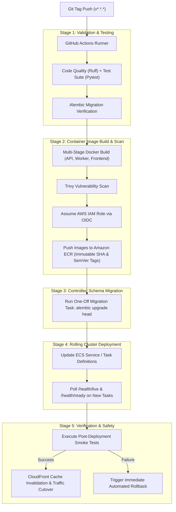

# Cloud Deployment Strategy & CI/CD Pipeline

## 1. End-to-End Delivery Pipeline

The deployment strategy automates the progression from Git commit to verified production release on AWS using GitHub Actions OIDC federation:



---

## 2. Amazon ECR Image Lifecycle Strategy

Container images are stored in dedicated ECR repositories:
- `ai-research-assistant/backend`
- `ai-research-assistant/frontend`

### Tagging Invariants
- **Immutable Tags Enabled**: Tag mutability is disabled in ECR to prevent overwriting deployed images.
- **Dual Tagging**: Every build is tagged with both the git commit SHA (`sha-7a8b9c0`) and semantic release tag (`v1.2.0`).

### ECR Lifecycle Policy (Auto-Pruning)
```json
{
  "rules": [
    {
      "rulePriority": 1,
      "description": "Retain only the last 15 tagged production images",
      "selection": {
        "tagStatus": "tagged",
        "tagPrefixList": ["v", "sha-"],
        "countType": "imageCountMoreThan",
        "countNumber": 15
      },
      "action": {
        "type": "expire"
      }
    },
    {
      "rulePriority": 2,
      "description": "Expire untagged images older than 7 days",
      "selection": {
        "tagStatus": "untagged",
        "countType": "sinceImagePushed",
        "countUnit": "days",
        "countNumber": 7
      },
      "action": {
        "type": "expire"
      }
    }
  ]
}
```

---

## 3. Database Schema Evolution: Expand-Contract Pattern

During rolling deployments, old and new application containers run concurrently for several minutes. Database migrations must never introduce breaking changes that crash older running instances.

```text
Phase 1: Expand  -> Add new nullable columns, tables, or indices (e.g. `outbox_events`).
                    Old code ignores new columns; system remains healthy.
Phase 2: Migrate -> Deploy code version writing to both old and new schema fields.
Phase 3: Switch  -> Deploy new code reading exclusively from new schema fields.
Phase 4: Contract-> Once all old container versions are terminated, execute a final
                    migration dropping deprecated columns or constraints.
```

---

## 4. Post-Deployment Smoke Testing & Automated Rollback

### Automated Verification Hook
Immediately following ECS task registration, GitHub Actions executes [`scripts/smoke_test_deployment.py`](file:///c:/Users/kayus/OneDrive/Desktop/learning-ai-from-scratch/projects/ai-research-assistant/scripts/smoke_test_deployment.py):
1. `GET /health/live`: Asserts application process liveness (HTTP 200).
2. `GET /health/ready`: Asserts database, Redis, and vector dependencies are reachable (HTTP 200).
3. Auth Token Gate: Tests JWT authentication flow.
4. Tenant Isolation Check: Verifies unauthorized document requests receive HTTP 401/403.

### Automated Rollback Trigger
If any health probe or smoke test fails:
1. CI/CD initiates an automatic rollback by updating the ECS service to reference the previous known-good task definition revision.
2. In-flight tasks running the faulty release are terminated.
3. Alert is dispatched to on-call engineers via SNS and Slack.
