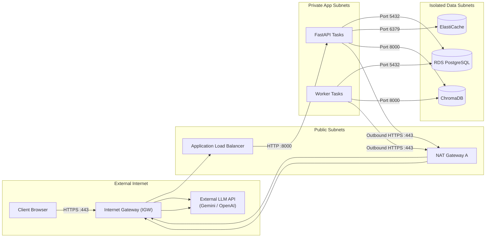

# VPC Network Design & Security Group Architecture

## 1. VPC CIDR & Subnet Allocation Plan

The AI Research Assistant network is built upon an isolated Amazon VPC using the non-overlapping CIDR block `10.0.0.0/16` across two Availability Zones (`us-east-1a` and `us-east-1b`).

### Three-Tier Subnet Layout (Task B)

```text
VPC Range: 10.0.0.0/16 (65,536 Total IPs)
├── Public Tier (Ingress & Outbound NAT) -> 2 Subnets (/24)
├── Private Application Tier (API & Workers) -> 2 Subnets (/24)
└── Isolated Data Tier (Databases & Caches) -> 2 Subnets (/24)
```

| Subnet Identifier | CIDR Block | Availability Zone | Usable IPs | Assigned Workloads | Internet Exposure |
|---|---|---|---|---|---|
| **`public-a`** | `10.0.1.0/24` | `us-east-1a` (AZ-A) | 251 | Internet ALB, NAT Gateway A | Direct Public Inbound / Outbound |
| **`public-b`** | `10.0.2.0/24` | `us-east-1b` (AZ-B) | 251 | Internet ALB, NAT Gateway B | Direct Public Inbound / Outbound |
| **`app-a`** | `10.0.11.0/24` | `us-east-1a` (AZ-A) | 251 | FastAPI API Tasks, Ingestion Workers | Outbound via NAT A; No Direct Inbound |
| **`app-b`** | `10.0.12.0/24` | `us-east-1b` (AZ-B) | 251 | FastAPI API Tasks, Ingestion Workers | Outbound via NAT B; No Direct Inbound |
| **`data-a`** | `10.0.21.0/24` | `us-east-1a` (AZ-A) | 251 | RDS Primary, ElastiCache Primary, ChromaDB | **Strictly Isolated** (No Inbound/Outbound Internet) |
| **`data-b`** | `10.0.22.0/24` | `us-east-1b` (AZ-B) | 251 | RDS Standby, ElastiCache Replica | **Strictly Isolated** (No Inbound/Outbound Internet) |

---

## 2. Route Table Architecture

Traffic routing follows strict defense-in-depth principles:



### Route Table Rules Table

| Route Table | Associated Subnets | Destination | Target | Purpose |
|---|---|---|---|---|
| **`rt-public`** | `public-a`, `public-b` | `10.0.0.0/16`<br/>`0.0.0.0/0` | `local`<br/>`igw-xxxxxxxx` | Local VPC communication.<br/>Default internet access for ALB and NAT Gateways. |
| **`rt-app-a`** | `app-a` | `10.0.0.0/16`<br/>`0.0.0.0/0`<br/>`s3-prefix-list` | `local`<br/>`nat-xxxxxxxx-a`<br/>`vpce-s3-gateway` | Local VPC communication.<br/>Outbound internet for AZ-A via NAT A.<br/>Direct S3 traffic via free Gateway Endpoint. |
| **`rt-app-b`** | `app-b` | `10.0.0.0/16`<br/>`0.0.0.0/0`<br/>`s3-prefix-list` | `local`<br/>`nat-xxxxxxxx-b`<br/>`vpce-s3-gateway` | Local VPC communication.<br/>Outbound internet for AZ-B via NAT B.<br/>Direct S3 traffic via free Gateway Endpoint. |
| **`rt-isolated-data`** | `data-a`, `data-b` | `10.0.0.0/16` | `local` | **Zero Internet Route**. Blocks data plane from internet access. |

---

## 3. Security Group Matrix (Task C)

Access is strictly controlled by referencing source and destination Security Groups rather than open IP CIDR blocks:

| Security Group ID | Resource | Inbound Rules (Source $\rightarrow$ Port) | Outbound Rules (Destination $\rightarrow$ Port) | Security Justification |
|---|---|---|---|---|
| **`sg-alb`** | Application Load Balancer | `0.0.0.0/0` $\rightarrow$ `443` (HTTPS)<br/>`0.0.0.0/0` $\rightarrow$ `80` (HTTP redirect) | `sg-api` $\rightarrow$ `8000` (HTTP) | Public entry point; forwards traffic exclusively to private API containers. |
| **`sg-api`** | FastAPI ECS Tasks | `sg-alb` $\rightarrow$ `8000` (HTTP) | `sg-rds` $\rightarrow$ `5432`<br/>`sg-redis` $\rightarrow$ `6379`<br/>`sg-chroma` $\rightarrow$ `8000`<br/>`sg-vpce` $\rightarrow$ `443`<br/>`0.0.0.0/0` $\rightarrow$ `443` (NAT) | Rejects direct internet traffic. Communicates only with ALB, data stores, and outbound NAT for external LLM calls. |
| **`sg-worker`** | Ingestion Workers | None (No inbound listeners) | `sg-rds` $\rightarrow$ `5432`<br/>`sg-chroma` $\rightarrow$ `8000`<br/>`sg-vpce` $\rightarrow$ `443`<br/>`0.0.0.0/0` $\rightarrow$ `443` (NAT) | Workers initiate outbound connections to SQS, RDS, ChromaDB, S3, and external LLM APIs. Zero open inbound ports. |
| **`sg-rds`** | RDS PostgreSQL | `sg-api` $\rightarrow$ `5432`<br/>`sg-worker` $\rightarrow$ `5432` | None (Stateful responses only) | Database accepts connections exclusively from authenticated API and worker security groups. |
| **`sg-redis`** | ElastiCache Redis | `sg-api` $\rightarrow$ `6379` | None (Stateful responses only) | Cache is restricted exclusively to API instances. |
| **`sg-chroma`** | ChromaDB Server | `sg-api` $\rightarrow$ `8000`<br/>`sg-worker` $\rightarrow$ `8000` | None (Stateful responses only) | Vector queries accepted only from API and worker tiers. |
| **`sg-vpce`** | VPC Endpoints | `sg-api` $\rightarrow$ `443`<br/>`sg-worker` $\rightarrow$ `443` | None (Stateful responses only) | Allows private API calls to AWS Secrets Manager, ECR, and CloudWatch without traversing the public internet. |

---

## 4. NAT Gateway & VPC Endpoints Strategy

### Outbound External Traffic (NAT Gateway)
The backend requires outbound internet connectivity to communicate with external LLM APIs (e.g. Google Gemini API at `generativelanguage.googleapis.com` or OpenAI at `api.openai.com`).
- **Design Decision**: Deploy one NAT Gateway per Availability Zone in public subnets (`public-a` and `public-b`).
- **Why**: Keeps application workloads in private subnets without public IPv4 addresses, mitigating direct internet vulnerability scans while maintaining high-availability outbound routing.

### Internal AWS Traffic (VPC Endpoints vs. NAT)
Traversing a NAT Gateway incurs hourly charges (\$0.045/hr) plus data processing charges (\$0.045/GB). For high-throughput internal AWS service access:

1. **S3 Gateway Endpoint (`com.amazonaws.us-east-1.s3`)**:
   - **Cost**: **$0.00 (Free)**.
   - **Decision**: **Enabled immediately**. Adds route table entries (`pl-xxxx`) directing all S3 document uploads and downloads internally without NAT processing fees.
2. **Interface VPC Endpoints (AWS PrivateLink)**:
   - Evaluated for `secretsmanager`, `ecr.api`, `ecr.dkr`, and `logs`.
   - **Cost**: \$0.01/hr per AZ + \$0.01/GB data processed.
   - **Decision**: In production environments, enable interface endpoints for ECR and Secrets Manager to enforce zero internet egress for container images and database credentials.
