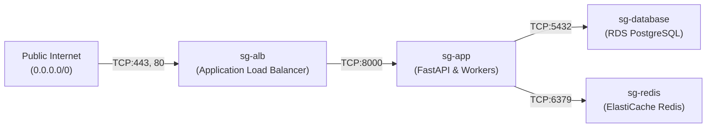

# AWS Infrastructure & Networking Implementation Guide

## 1. Executive Summary & Architectural Scope

This implementation turns the high-level cloud architecture from Day 179 and the Terraform foundations from Day 180 into a fully realized, secure **AWS 3-Tier Multi-AZ Networking & Container Registry Foundation** for the **AI Research Assistant**.

The central focus is production readiness, security boundaries, and defense-in-depth:
- **Public Subnets**: Host the Application Load Balancer (ALB) and NAT Gateway.
- **Private Application Subnets**: Host stateless FastAPI containers and Celery ingestion workers.
- **Isolated Data Subnets**: Host PostgreSQL (RDS), Redis (ElastiCache), and vector storage (ChromaDB) with **zero default internet or NAT route**.
- **S3 Gateway VPC Endpoint**: Direct, cost-free document traffic to S3 without traversing NAT Gateways.
- **Security Group Isolation**: Strict chained ingress boundaries where database and cache ports are accessible only from application security groups.
- **Immutable Container Registries (ECR)**: Cryptographically immutable image repositories with automated vulnerability scanning on push and rollback-preserving lifecycle policies.

---

## 2. Target Network Topology & Traffic Flow

```mermaid
flowchart TD
    subgraph InternetLayer ["Public Internet"]
        Client["Browser / API Client"]
    end

    subgraph VPC ["AWS VPC (10.0.0.0/16)"]
        IGW["Internet Gateway (IGW)"]

        subgraph AZ_A ["Availability Zone A (ap-south-1a)"]
            subgraph PublicA ["Public Subnet (10.0.1.0/24)"]
                ALB_A["ALB Node A"]
                NAT_GW["NAT Gateway (EIP)"]
            end

            subgraph PrivAppA ["Private App Subnet (10.0.11.0/24)"]
                API_A["FastAPI Task (Port 8000)"]
                Worker_A["Ingestion Worker"]
            end

            subgraph DataA ["Isolated Data Subnet (10.0.21.0/24)"]
                RDS_Primary[("PostgreSQL Primary (5432)")]
                Redis_A[("Redis Master (6379)")]
            end
        end

        subgraph AZ_B ["Availability Zone B (ap-south-1b)"]
            subgraph PublicB ["Public Subnet (10.0.2.0/24)"]
                ALB_B["ALB Node B"]
            end

            subgraph PrivAppB ["Private App Subnet (10.0.12.0/24)"]
                API_B["FastAPI Task (Port 8000)"]
                Worker_B["Ingestion Worker"]
            end

            subgraph DataB ["Isolated Data Subnet (10.0.22.0/24)"]
                RDS_Standby[("PostgreSQL Standby (5432)")]
                Redis_B[("Redis Replica (6379)")]
            end
        end

        subgraph VPCEndpoints ["VPC Gateway Endpoints"]
            S3Endpoint["com.amazonaws.ap-south-1.s3<br/>(Gateway Endpoint)"]
        end
    end

    subgraph AWSServices ["AWS Managed Cloud Services"]
        S3Bucket[("S3 Documents Bucket<br/>(SSE-AES256 Encrypted)")]
        ECR_API["ECR: ai-research-assistant-api"]
        ECR_Worker["ECR: ai-research-assistant-worker"]
        ECR_Frontend["ECR: ai-research-assistant-frontend"]
        ExternalLLM["External LLM Provider API<br/>(OpenAI / Gemini / Anthropic)"]
    end

    %% Ingress Flow
    Client -->|HTTPS:443| IGW
    IGW --> ALB_A & ALB_B
    ALB_A & ALB_B -->|HTTP:8000 (Internal)| API_A & API_B

    %% Database & Cache Flow
    API_A & API_B -->|TCP:5432 (Chained SG)| RDS_Primary
    Worker_A & Worker_B -->|TCP:5432 (Chained SG)| RDS_Primary
    API_A & API_B -->|TCP:6379 (Chained SG)| Redis_A
    Worker_A & Worker_B -->|TCP:6379 (Chained SG)| Redis_A

    %% Replication
    RDS_Primary -.->|Sync Replication| RDS_Standby
    Redis_A -.->|Async Replication| Redis_B

    %% S3 Direct Gateway Flow
    API_A & API_B --> S3Endpoint --> S3Bucket
    Worker_A & Worker_B --> S3Endpoint --> S3Bucket
    DataA -.-> S3Endpoint
    DataB -.-> S3Endpoint

    %% Egress Flow to LLM via NAT
    PrivAppA & PrivAppB --> NAT_GW --> IGW --> ExternalLLM
```

---

## 3. Subnet Allocation & CIDR Matrix

The VPC CIDR `10.0.0.0/16` provides 65,536 addresses, subdivided into three dedicated tiers across two Availability Zones (`ap-south-1a`, `ap-south-1b`):

| Subnet Tier | CIDR Block | AZ | Usable IPs | Internet Gateway Access | NAT Gateway Egress | Primary Purpose |
|---|---|---|---|---|---|---|
| **Public AZ-A** | `10.0.1.0/24` | `ap-south-1a` | 251 | Yes (`0.0.0.0/0 -> IGW`) | N/A (Direct) | ALB listener, NAT Gateway |
| **Public AZ-B** | `10.0.2.0/24` | `ap-south-1b` | 251 | Yes (`0.0.0.0/0 -> IGW`) | N/A (Direct) | ALB listener secondary AZ |
| **Private App AZ-A** | `10.0.11.0/24` | `ap-south-1a` | 251 | No | Yes (`0.0.0.0/0 -> NAT`) | FastAPI API tasks, Celery worker |
| **Private App AZ-B** | `10.0.12.0/24` | `ap-south-1b` | 251 | No | Yes (`0.0.0.0/0 -> NAT`) | FastAPI API tasks, Celery worker |
| **Isolated Data AZ-A** | `10.0.21.0/24` | `ap-south-1a` | 251 | **None** | **None** | RDS PostgreSQL Primary, Redis Master |
| **Isolated Data AZ-B** | `10.0.22.0/24` | `ap-south-1b` | 251 | **None** | **None** | RDS PostgreSQL Standby, Redis Replica |

---

## 4. Route Table Design & Isolation Verification

### 4.1 Public Route Table
- Associated Subnets: `10.0.1.0/24` and `10.0.2.0/24`.
- Default Route: `0.0.0.0/0` targeted to `aws_internet_gateway.this.id`.
- Permits inbound client HTTPS traffic to ALB and outbound traffic from the NAT Gateway.

### 4.2 Private Application Route Tables
- Associated Subnets: `10.0.11.0/24` and `10.0.12.0/24`.
- Default Route: `0.0.0.0/0` targeted to `aws_nat_gateway.this.id`.
- S3 Route: Direct Gateway Route (`pl-xxxxxxx -> vpce-xxxxxxx`) configured automatically by the S3 VPC endpoint.
- Protects workloads from unsolicited internet scans while allowing outbound egress to external LLM providers (Gemini, OpenAI, Anthropic).

### 4.3 Isolated Database Route Tables
- Associated Subnets: `10.0.21.0/24` and `10.0.22.0/24`.
- Default Route: **NONE**.
- NAT Route: **NONE**.
- Local VPC Route: `10.0.0.0/16 -> local`.
- S3 Route: Direct Gateway Route (`pl-xxxxxxx -> vpce-xxxxxxx`).
- **Why this design is critical**:
  1. Even if an attacker compromises credentials, database instances cannot be reached from the public internet.
  2. Database servers cannot initiate arbitrary outbound connections to external Command & Control (C2) servers or exfiltrate data, neutralizing a massive class of injection and data-theft vulnerabilities.

---

## 5. Security Group Chaining Matrix

AWS Security Groups are stateful virtual firewalls evaluated at the Elastic Network Interface (ENI) level. Rather than using vulnerable CIDR-based rules, our infrastructure enforces **Security Group Chaining**:



| Security Group | Ingress Source | Ports & Protocol | Egress Destination | Description |
|---|---|---|---|---|
| `sg-alb` | `0.0.0.0/0` | TCP `443` (HTTPS), `80` (HTTP redirect) | `0.0.0.0/0` | Public load balancer perimeter |
| `sg-application` | `sg-alb` | TCP `8000` | `0.0.0.0/0` (via NAT) | FastAPI application API & workers |
| `sg-database` | `sg-application` | TCP `5432` (PostgreSQL) | Local VPC | Metadata store strictly isolated |
| `sg-redis` | `sg-application` | TCP `6379` (Redis) | Local VPC | Cache & task queue strictly isolated |

> [!IMPORTANT]
> `0.0.0.0/0` is strictly forbidden in database and Redis ingress rules. Ingress is restricted solely to the application security group ID.

---

## 6. S3 Gateway VPC Endpoint Architecture

The AI Research Assistant processes, extracts, and vectorizes large PDF documents stored in Amazon S3. 

### Why Use a Gateway VPC Endpoint?
1. **Zero Data Transfer Cost**: S3 Gateway VPC Endpoints are completely free. Bypassing the NAT Gateway saves \$0.045 per gigabyte of document transfer.
2. **Enhanced Security**: Traffic remains entirely within the AWS global backbone. It never exits onto the public internet.
3. **No Network Bottleneck**: The Gateway endpoint modifies the route tables of the private and database subnets directly with a prefix list route (`pl-xxxxxxx`).

```hcl
resource "aws_vpc_endpoint" "s3" {
  vpc_id            = aws_vpc.this.id
  service_name      = "com.amazonaws.${var.aws_region}.s3"
  vpc_endpoint_type = "Gateway"

  route_table_ids = concat(
    aws_route_table.private[*].id,
    aws_route_table.database[*].id
  )

  tags = merge(var.tags, {
    Name = "${var.name}-s3-endpoint"
  })
}
```

---

## 7. Container Registry (ECR) Implementation

We provision dedicated, hardened repositories for the three containerized services:
- `ai-research-assistant-api` (FastAPI REST service)
- `ai-research-assistant-worker` (Document extraction & indexing workers)
- `ai-research-assistant-frontend` (Nginx + React SPA)

### Key Security Controls:
1. **Tag Immutability (`IMMUTABLE`)**: Prevents overwriting release tags (e.g., `v1.2.0` or `git-sha`). Guarantees that what was tested and deployed in staging is bit-for-bit identical to production.
2. **Automated Vulnerability Scanning on Push (`scan_on_push = true`)**: Scans container layers against Common Vulnerabilities and Exposures (CVE) databases immediately upon receipt.
3. **Encryption at Rest**: AES-256 server-side encryption.
4. **Lifecycle Retention Policy**:
   - Retains the 15 most recent tagged production releases (`v*`, `sha-*`, `prod-*`) for rapid rollback.
   - Automatically purges untagged layers older than 7 days to eliminate storage bloat.

---

## 8. Remaining Production Deployment Gaps & Roadmap

While the networking foundation is complete and code-validated, moving to active live cloud provisioning requires the following production operational extensions:

| Area | Current Implementation Status | Production Requirement |
|---|---|---|
| **NAT Gateway High Availability** | Single NAT Gateway in Public AZ-A (Cost-optimized for dev) | Multi-AZ NAT Gateways (1 per AZ) to eliminate single-AZ egress failure risk in production. |
| **Perimeter Protection** | ALB Security Group | AWS WAF (Web Application Firewall) attached to ALB with rate-limiting, SQLi, and OWASP Top 10 rule sets. |
| **Network Observability** | Subnet metrics | AWS VPC Flow Logs capturing all accepted and rejected IP packets delivered to Amazon CloudWatch Logs / S3. |
| **DNS & SSL/TLS** | ALB HTTP/HTTPS listeners configured | Route 53 Hosted Zone record + AWS Certificate Manager (ACM) public TLS certificate with DNS validation. |
| **Key Management** | Default AWS AES-256 | AWS KMS Customer Managed Keys (CMK) with automated annual rotation for S3 and RDS storage encryption. |
| **Database Compute** | Database Subnets & Security Groups ready | Provisioning `aws_db_instance` (PostgreSQL Multi-AZ) with DB subnet group association. |

---

## 9. Verification & Plan Review Checklist

- [x] **VPC CIDR Validated**: `10.0.0.0/16` with DNS hostnames and DNS resolution enabled.
- [x] **Subnet Counts & Boundaries**: 2 public subnets, 2 private application subnets, 2 isolated database subnets across 2 AZs.
- [x] **Database Isolation**: Database subnets have no default internet route and no NAT route.
- [x] **Public Route Table**: Points default route (`0.0.0.0/0`) to Internet Gateway.
- [x] **Private Route Tables**: Point default route (`0.0.0.0/0`) to NAT Gateway.
- [x] **S3 Gateway Endpoint**: Attached to all private and database route tables.
- [x] **Chained Security Groups**: PostgreSQL (5432) and Redis (6379) restricted strictly to Application Security Group.
- [x] **ECR Hardening**: Immutable image tags, vulnerability scanning on push, and retention lifecycle policies.
- [x] **Zero Hardcoded Secrets**: All identifiers, regions, and CIDRs managed via variables and locals.
