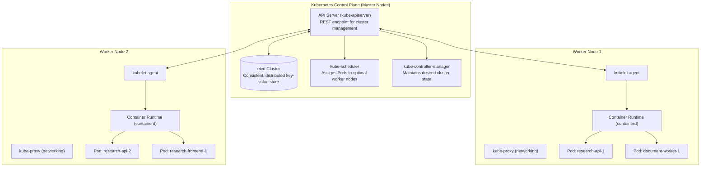
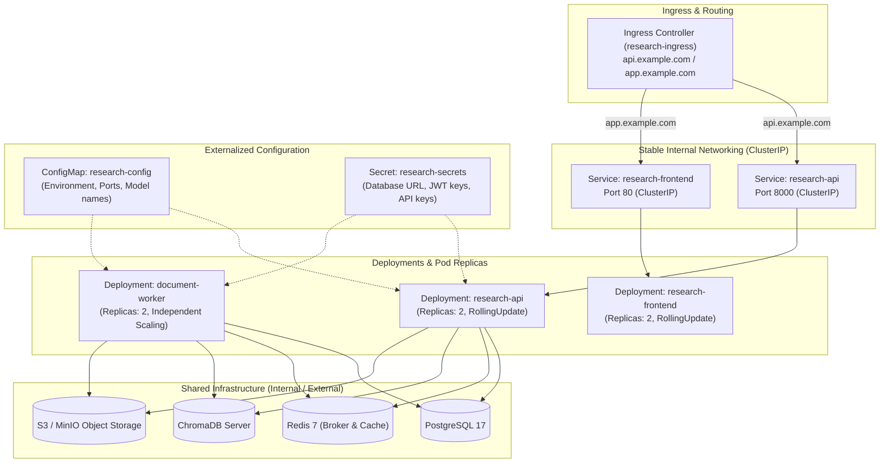
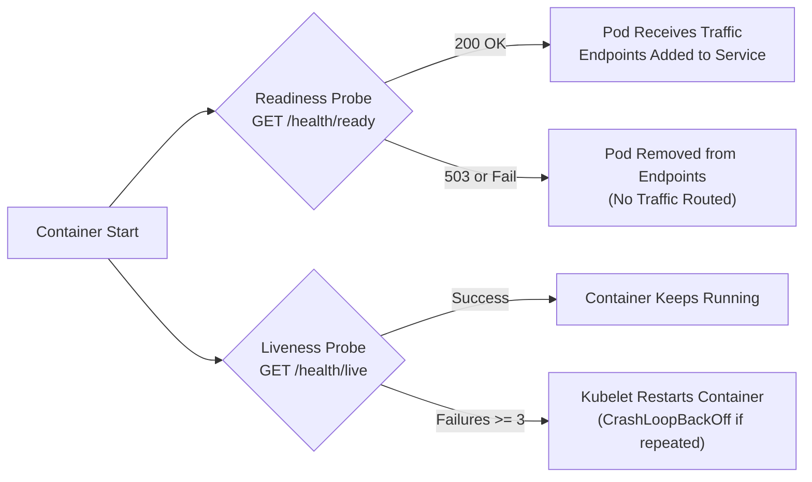
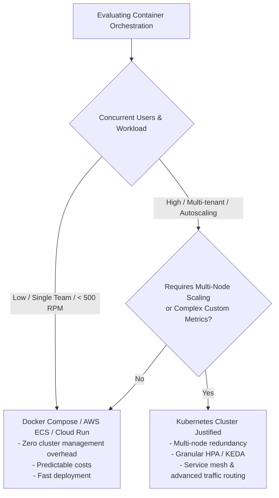

# Kubernetes Architecture & Container Orchestration

## 1. Overview & Architectural Philosophy

Kubernetes (K8s) provides declarative container orchestration for the **AI Research Assistant**. While Docker packages the application into reproducible images, Kubernetes manages workloads across multiple physical or virtual machines, providing automated scheduling, self-healing, rolling deployments, horizontal autoscaling, and service discovery.

> **Engineering Principle**: Kubernetes is an infrastructure capability, not a mandatory prerequisite for every AI project. A well-configured single-node Docker Compose or managed container service (AWS ECS, Google Cloud Run) is often sufficient for early-to-mid stage workloads. Kubernetes becomes justified when scaling across multiple nodes, requiring complex autoscaling rules, or integrating into enterprise multi-tenant cloud platforms.

---

## 2. Kubernetes Control Plane vs. Worker Nodes



### Component Responsibilities

| Tier | Component | Function |
|---|---|---|
| **Control Plane** | **`kube-apiserver`** | The front door of the control plane; validates and configures data for pods, services, replication controllers, and others. |
| **Control Plane** | **`etcd`** | Consistent and highly-available key-value store used as Kubernetes' backing store for all cluster data. |
| **Control Plane** | **`kube-scheduler`** | Watches for newly created Pods with no assigned node, and selects a node for them to run on based on resource requests, constraints, and affinity rules. |
| **Control Plane** | **`kube-controller-manager`** | Runs controller processes (Deployment controller, Node controller, EndpointSlice controller, Namespace controller). |
| **Worker Node** | **`kubelet`** | An agent running on each node ensuring that containers are running in a Pod according to the PodSpec. |
| **Worker Node** | **`containerd / CRI-O`** | Container runtime responsible for pulling images, allocating namespaces, and executing containers. |
| **Worker Node** | **`kube-proxy`** | Maintains network rules on nodes allowing network communication to Pods from inside or outside of the cluster. |

---

## 3. Workload Topology & Object Relationships

The AI Research Assistant deploys stateless API replicas, static frontend web servers, and compute-heavy background workers as decoupled Deployments.



---

## 4. Workload Separation: API vs. Ingestion Workers

A critical architectural decision is running **FastAPI instances** and **Ingestion Workers** under separate Deployments despite using the same base container image (`research-api:1.0.0`):

| Property | `research-api` (FastAPI) | `document-worker` (Background Worker) |
|---|---|---|
| **Workload Profile** | I/O-bound, low CPU, low memory, latency-sensitive. | CPU-intensive (PDF parsing), memory-heavy (embeddings), batch-oriented. |
| **Resource Requests** | `cpu: 250m`, `memory: 512Mi` | `cpu: 500m`, `memory: 1Gi` |
| **Resource Limits** | `cpu: 1000m`, `memory: 1Gi` | `cpu: 2000m`, `memory: 3Gi` |
| **Networking** | Exposed via ClusterIP Service and Ingress. | None (consumes tasks from Redis, writes to DB/S3/Chroma). |
| **Autoscaling Metric** | CPU utilization & HTTP request rates (HPA). | Redis queue depth & oldest job age (KEDA / custom metric). |
| **Termination Policy** | Rapid draining with 5-second `preStop` sleep. | Graceful SIGTERM with time to finish in-flight document indexing. |

---

## 5. Health Probes & Lifecycle Management

Kubernetes uses probes to make automated scheduling and routing decisions:

### Probe Mechanics


1. **Readiness Probe (`GET /health/ready`)**:
   - Validates that the application can communicate with PostgreSQL, Redis, and ChromaDB.
   - If PostgreSQL has a temporary blip, readiness fails: **traffic is routed to other healthy pods without killing this container**.
2. **Liveness Probe (`GET /health/live`)**:
   - Validates that the Python/Uvicorn process is responsive and the event loop is not deadlocked.
   - If liveness fails 3 consecutive times, **Kubelet terminates and restarts the container**.
3. **Graceful Termination (`preStop` Hook)**:
   - When a pod is being retired during a rolling update, `preStop` executes `sleep 5`. This gives the Ingress controller and `kube-proxy` time to propagate endpoint removal before the container receives `SIGTERM`.

---

## 6. Zero-Downtime Rolling Deployments & Rollbacks

Deployments configure a `RollingUpdate` strategy to ensure continuous availability:

```yaml
strategy:
  type: RollingUpdate
  rollingUpdate:
    maxSurge: 1        # Allow at most 1 extra Pod above desired replicas during rollout
    maxUnavailable: 0  # Ensure 100% of desired replicas remain available at all times
```

### Rollout Process:
1. Kubernetes spins up 1 new Pod (`v2`).
2. Traffic is withheld until `v2` passes the `readinessProbe`.
3. Once `v2` is ready, Kubernetes terminates 1 old Pod (`v1`).
4. Step repeats until all replicas run `v2`.

### Rollback Process:
If a release causes runtime regressions or fails health checks:
```bash
# Immediately roll back to previous deployment revision
kubectl rollout undo deployment/research-api -n research-assistant
```
> **Warning**: Rolling back application pods reverses the container image, but does **not** automatically rollback database migrations. Database schemas must follow the **Expand-Contract** pattern so older container versions remain compatible with newer database columns.

---

## 7. Horizontal Pod Autoscaling (HPA)

The API deployment includes an HPA resource (`k8s/backend-hpa.yaml`):

- **Target Deployment**: `research-api`
- **Bounds**: Minimum 2 pods, maximum 8 pods.
- **Trigger**: Average CPU utilization $\ge 70\%$ or Memory utilization $\ge 80\%$.
- **Stabilization Window**: Scale-down requires a 300-second stabilization window to prevent "flapping" (rapid oscillations between scaling up and down).

### Why CPU Scaling is Insufficient for AI Workers
For `document-worker`, CPU utilization is a lagging indicator. Workers running at 100% CPU might be processing 2 documents or 2,000 documents. The optimal scaling signal for background workers is **Redis Queue Depth** (`LLEN rq:queue:document-indexing`), implemented in advanced clusters via **KEDA (Kubernetes Event-driven Autoscaling)**.

---

## 8. Common Failure Modes & Diagnostics Runbook

| Status | Root Cause | Diagnostic Steps | Mitigation |
|---|---|---|---|
| **`ImagePullBackOff`** | Invalid image tag, wrong registry URL, or missing pull secret. | `kubectl describe pod <name> -n research-assistant` | Check `image:` tag; configure `imagePullSecrets`. |
| **`CrashLoopBackOff`** | Container process exits with non-zero exit code immediately on boot. | `kubectl logs <name> -n research-assistant --previous` | Check database credentials in `secret.yaml` or missing configuration keys. |
| **`OOMKilled`** | Container consumed more memory than `resources.limits.memory`. | `kubectl get pod <name> -o yaml \| grep -i oom` | Increase memory limit or tune embedding batch size (`EMBEDDING_BATCH_SIZE`). |
| **`Pending Pod`** | Insufficient CPU/memory across cluster nodes, or PVC cannot bind. | `kubectl describe pod <name> -n research-assistant` | Add cluster worker nodes or reduce `resources.requests`. |
| **`Readiness Failed`** | `/health/ready` returns 503 or fails to respond within timeout. | `kubectl logs <name> -n research-assistant` | Verify PostgreSQL or Redis connectivity from inside the pod. |
| **Service has No Endpoints** | Service selector does not match pod labels. | `kubectl get endpoints <svc-name> -n research-assistant` | Align `spec.selector` in Service with `spec.template.metadata.labels` in Deployment. |

---

## 9. When Kubernetes is Unnecessary vs. Appropriate



### Don't Use Kubernetes If:
- Your team lacks dedicated SRE / platform engineering expertise.
- Your entire workload fits comfortably on a single beefy instance (e.g. 16 vCPUs, 64GB RAM).
- A managed service (AWS App Runner, ECS, Google Cloud Run) satisfies your availability and scaling requirements.

### Do Use Kubernetes If:
- You operate a multi-node cluster requiring distributed scheduling and bin-packing.
- You need automated self-healing, rolling zero-downtime updates, and declarative infrastructure-as-code across multi-cloud environments.
- You have diverse heterogeneous workloads (GPU nodes for model inference, memory nodes for vector databases, CPU nodes for web APIs).
