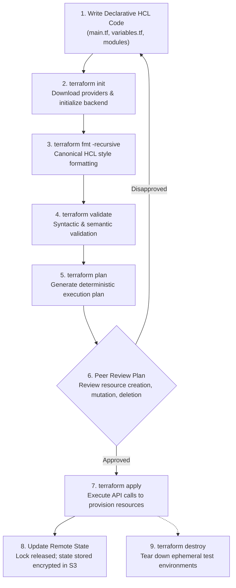

# Infrastructure as Code (IaC) with Terraform

## 1. Executive Summary & IaC Principles

This guide establishes the **Infrastructure as Code (IaC)** foundation for the **AI Research Assistant** on Amazon Web Services (AWS) using HashiCorp Terraform.

### The Central Principle of Infrastructure as Code
> **Declarative Reproducibility**: Your cloud infrastructure must be completely reproducible, auditable, and version-controlled through declarative configuration files—never dependent on undocumented manual operations in the AWS Console.

Manual infrastructure provisioning creates configuration drift, non-reproducible environments, missing audit trails, and human error. With Terraform, the entire AWS footprint (VPC, subnets, S3 storage, ECR registries, routing, and access controls) is declared as code, reviewed in pull requests, and verified via automated CI/CD pipelines.

---

## 2. Terraform Execution Lifecycle



### Core CLI Commands

| Command | Action | Key Flags & Nuances |
|---|---|---|
| `terraform init` | Initializes working directory, downloads AWS provider plugins, and configures state backend. | `-backend=false` for local offline CI validation. |
| `terraform fmt` | Rewrites Terraform configuration files to canonical format and style. | `-recursive` formats all subdirectories; `-check` validates formatting in CI. |
| `terraform validate` | Verifies configuration syntax, argument types, and module declarations without connecting to cloud APIs. | Must be executed after `terraform init`. |
| `terraform plan` | Compares declared code against state and live cloud resources to generate an execution preview. | **Does not provision infrastructure**. Inspect before applying. |
| `terraform apply` | Provisions or modifies AWS resources according to the approved plan. | Use `-auto-approve` only in strictly controlled, pre-reviewed CI environments. |
| `terraform destroy` | Destroys all infrastructure managed by the configuration. | Requires confirmation; destructive and irreversible. |

---

## 3. Terraform Architecture & Modular Project Structure

The project separates reusable infrastructure building blocks (modules) from environment-specific instantiations (`dev`, `prod`):

```text
infrastructure/terraform/
├── versions.tf                  # Minimum Terraform (>= 1.6.0) & AWS provider (~> 6.0)
├── providers.tf                 # AWS provider configuration & default tags
├── variables.tf                 # Root input variable definitions & validations
├── locals.tf                    # Computed local values (name_prefix, common_tags)
├── main.tf                      # Root composition calling storage, networking, registry
├── outputs.tf                   # Exposed attributes (VPC ID, bucket ARN, ECR URLs)
├── backend.tf                   # S3 remote state backend configuration with locking
├── terraform.tfvars.example     # Sample environment inputs template
├── .gitignore                   # Excludes .terraform/, *.tfstate, *.tfvars, *.tfplan
├── modules/
│   ├── storage/                 # Reusable S3 document storage module
│   │   ├── main.tf              # Bucket, versioning, AES-256 encryption, public access block
│   │   ├── variables.tf         # bucket_name, enable_versioning, tags
│   │   └── outputs.tf           # bucket_name, bucket_arn, bucket_id
│   ├── networking/              # Reusable 3-tier VPC networking module
│   │   ├── main.tf              # VPC, IGW, public/private/database subnets, route tables
│   │   ├── variables.tf         # vpc_cidr, availability_zones, subnet lists
│   │   └── outputs.tf           # vpc_id, subnet IDs lists, igw_id
│   └── registry/                # Reusable ECR container registry module
│       ├── main.tf              # ECR repositories, immutable tags, lifecycle policies
│       ├── variables.tf         # repository_names, scan_on_push, tags
│       └── outputs.tf           # repository_urls, repository_arns
└── environments/
    ├── dev/                     # Development environment workspace
    │   ├── main.tf              # Calls root module with dev inputs & dev state key
    │   ├── variables.tf         # Dev-specific variable overrides
    │   ├── outputs.tf           # Dev-specific outputs
    │   └── terraform.tfvars     # Dev variable values
    └── prod/                    # Production environment workspace
        ├── main.tf              # Calls root module with prod inputs & prod state key
        ├── variables.tf         # Prod-specific variable overrides
        ├── outputs.tf           # Prod-specific outputs
        └── terraform.tfvars     # Prod variable values
```

---

## 4. Terraform State & Remote Backend Strategy

### What is Terraform State?
Terraform records mapping between your declared HCL configuration and physical AWS resources in a JSON state file (`terraform.tfstate`). State is necessary to:
1. **Map Resources**: Track that `aws_s3_bucket.this` corresponds to physical S3 bucket `ai-research-assistant-dev-documents-12345`.
2. **Determine Deltas**: Calculate what must be created, modified, or destroyed on `terraform plan`.
3. **Store Metadata**: Record resource dependencies, schema versions, and computed attributes.

### Remote State Backend (S3 + State Locking)
Never store production state locally. We configure an S3 remote backend:

```terraform
terraform {
  backend "s3" {
    bucket       = "ai-research-assistant-tfstate-bootstrap"
    key          = "ai-research-assistant/dev/terraform.tfstate"
    region       = "ap-south-1"
    encrypt      = true
    use_lockfile = true
  }
}
```

- **Encryption**: Enforces AES-256 / KMS server-side encryption because state files can contain database connection strings and passwords.
- **State Locking (`use_lockfile = true`)**: Prevents two engineers or CI pipelines from running `apply` concurrently, which would corrupt the state file.
- **Separate State Keys**: Dev and prod maintain distinct state keys (`.../dev/terraform.tfstate` vs `.../prod/terraform.tfstate`) to prevent accidental blast radius contamination.
- **Bootstrap Separation**: The state bucket itself must be created **before** Terraform initializes this configuration (using a minimal bootstrap script or CloudFormation template). Never manage the state bucket inside the configuration that uses it.

---

## 5. Drift Detection & Reconciliation

**Configuration Drift** occurs when cloud resources are modified outside of Terraform (e.g. an engineer manually opens a security group port in the AWS Console).

### Detecting and Resolving Drift:
1. `terraform plan` queries the AWS APIs and compares live reality against the stored state and HCL configuration.
2. If drift is detected, Terraform generates a plan to revert the out-of-band change back to the declared desired state.
3. If the manual change was intentional (e.g. an emergency incident response fix), update the HCL code to reflect the change before running `apply` to codify the fix permanently.

---

## 6. CI/CD for Terraform (GitHub Actions)

Infrastructure changes are verified in pull requests using [`.github/workflows/terraform.yml`](file:///c:/Users/kayus/OneDrive/Desktop/learning-ai-from-scratch/.github/workflows/terraform.yml):

```yaml
name: Terraform Validation

on:
  pull_request:
    paths:
      - "projects/ai-research-assistant/infrastructure/terraform/**"
  push:
    branches: [main]
    paths:
      - "projects/ai-research-assistant/infrastructure/terraform/**"

jobs:
  validate:
    runs-on: ubuntu-latest
    defaults:
      run:
        working-directory: projects/ai-research-assistant/infrastructure/terraform
    steps:
      - uses: actions/checkout@v4
      - uses: hashicorp/setup-terraform@v3
        with:
          terraform_version: "1.9.0"
      - name: Format Check
        run: terraform fmt -check -recursive
      - name: Init (No Backend)
        run: terraform init -backend=false
      - name: Validate
        run: terraform validate
```

---

## 7. Knowledge Checkpoint (Section 16 Answers)

1. **What problem does Terraform solve compared with manually creating AWS resources?**  
   Manual creation via the AWS Console is error-prone, undocumented, impossible to review in version control, and cannot be reliably reproduced across development, staging, and production environments. Terraform provides declarative, repeatable, auditable, and automated infrastructure as code.
2. **What is the difference between a Terraform resource and a data source?**  
   A **resource** instructs Terraform to create, manage, update, or destroy an infrastructure object (e.g. `aws_s3_bucket`). A **data source** performs a read-only query against existing infrastructure outside of Terraform's direct management (e.g. `data "aws_vpc" "existing"`).
3. **Why is Terraform state necessary?**  
   Terraform state maps your human-readable HCL configuration to real-world cloud resources, tracks metadata and resource dependencies, and stores cached attributes required to compute execution plans without making thousands of live API calls on every command.
4. **Why should remote state be protected and locked?**  
   State files often contain sensitive information (database passwords, generated keys). Storing it encrypted in remote storage (S3 with SSE-KMS and strict IAM) protects confidentiality. State locking prevents concurrent executions from conflicting and corrupting the state file.
5. **What happens when someone manually changes an AWS resource managed by Terraform?**  
   Configuration drift occurs. When `terraform plan` is next run, Terraform refreshes its view of live infrastructure, detects the disparity, and generates a plan to restore the resource to the state declared in code.
6. **Why are Terraform modules useful?**  
   Modules encapsulate related resources into reusable, parameterized packages. They eliminate code duplication across dev, staging, and prod, enforce organizational security standards, and simplify maintenance.
7. **Why should development and production use separate state?**  
   Sharing a single state file creates extreme blast-radius risk: an error, accidental deletion, or state lock during a development test could bring down production infrastructure. Separate state files completely isolate environments.
8. **Why should terraform plan be reviewed before terraform apply?**  
   `terraform plan` previews exactly what Terraform will add, change, replace, or destroy. Reviewing the plan prevents catastrophic unintended destructive operations (e.g. replacing an active RDS database or deleting an S3 bucket).
9. **Why should the state bucket be bootstrapped separately?**  
   Terraform cannot store its own state in an S3 bucket that it has not yet created. The remote backend must exist before running `terraform init`. Bootstrapping it independently solves this chicken-and-egg dependency.
10. **Why is Terraform validation different from actually deploying infrastructure?**  
    `terraform validate` checks HCL syntax, argument types, and module consistency statically. It does not contact cloud APIs, check AWS service quotas, verify IAM permissions, or validate whether a bucket name is globally unique on AWS.
